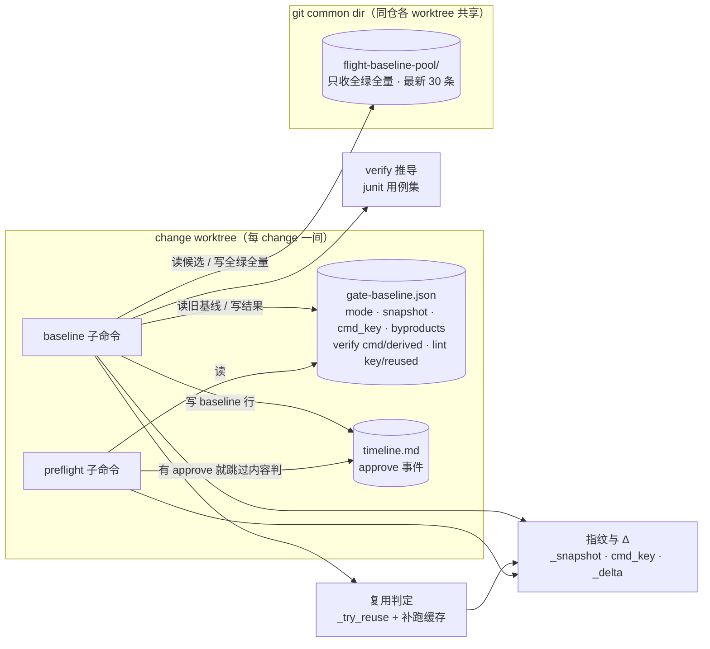
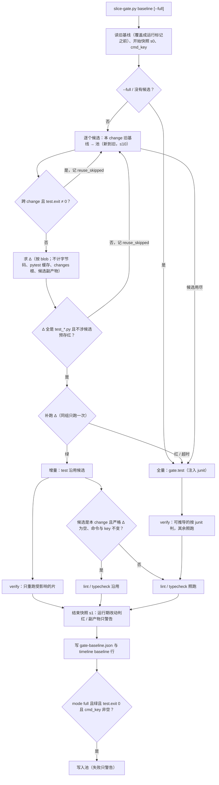

## Context

- **现状**（本仓 main `3f98011`）：
  - `cmd_baseline`（`template/.claude/hooks/slice-gate.py:1231`）每次都跑：全量 `gate.test` → lint / typecheck → 每片 verify。开跑先把 `gate-baseline.json` 覆盖成运行标记，结束时 `timeline_record` 写一行 baseline（`:1283`）。
  - `plan_sha`（`:230`）只认 gate 三条命令与每片 verify 命令的**字符串**。
  - `cmd_preflight`（`:1312`）四项校验：计划合法、基线 ok、plan_sha 一致、基线 commit 是 HEAD 的祖先。
  - `run_test_gate`（`:171`）exit 0 时不读 junit，只在可度量的 exit 1 时取 `failed`。
- **调用方**：
  - `/opsx-propose` 第 5 步后台跑 baseline；
  - `/opsx-apply` 第 3 步跑 preflight，第 4 步写 `approve` 事件并提交 timeline。
  - 本仓没有账本、没有「批准修订并续飞」。
- **来源**：原仓 #65（`855b834`）的 design D1–D9 与实现，以及它的 `review-findings.json` 里 13 条 deferred。原仓 #65 之前的 `cmd_baseline` 与本仓逐行相同，只差 timeline 的写法（原仓由账本生成 timeline，本仓 slice-gate 直接写）。
- **实测**（2026-10-15，本仓 main，`workflow-edition` 的计划）：
  - 全量 50.6 秒；lint 0.1 秒；4 片 verify 串行 49.0 秒；
  - 4 片 verify 跑的都是 `tests/` 下全量已经跑过的测试文件；
  - junit 的 classname 形如 `tests.test_one`（用例在类里时为 `tests.test_one.TestK`）；strict xfail 记为 `skipped type="pytest.xfail"`，不算失败。
- **用户决策（2026-10-15）**：
  - 移植 #65；
  - 跨 change 只复用全绿的全量；
  - 修 #65 的 deferred 问题；
  - lint / typecheck 在代码树没变时沿用；
  - verify 从全量结果推导；
  - 不做「lint / typecheck 与全量并行」。
- **约束**：
  - 铁律 3（测试由可信方运行，复用要有指纹为证）；
  - 铁律 5（门禁红不收口）；
  - 铁律 9（零 token 判定）；
  - 铁律 10（回退：`--full` 恒等于旧行为）；
  - ADR `DRAFT-test-gate-baseline-diff`（预存红差分口径不变）；
  - ADR `DRAFT-gate-evidence-not-self-reported`（判定不出 fail-closed）；
  - ADR `DRAFT-workflow-edition-repo` 第 3 条（依赖插件的部分在本仓重新设计）。

C4 组件视图（轻量，`slice-gate.py` 内部；数据存放位置是本 change 新增的关注点）：

baseline 的判定流程（动态视图）：

## Goals / Non-Goals

**Goals:**
- 改计划后重跑 baseline：代码树没变、或只改了测试文件时，不跑全量；代码树完全没变时连 lint / typecheck 也不跑。
- 同一仓库从同一个 main commit 切出的多个 change，全绿时全量只跑一次。
- 第一次全量基线里，可推导的 verify 不再重复跑测试（本仓实测约 49 / 100 秒）。
- 要不要重跑、重跑多少，由脚本判定；preflight 能看出内容变化。
- 修掉 #65 评审 deferred 的正确性与性能问题，不把它们带进本仓。

**Non-Goals:**
- 仓外漂移（数据仓、解释器环境、系统包）：不检测，用 `--full` 兜底。
- 被 source 或 import 的门禁脚本：不计入 `cmd_key`。
- final 的全量：不复用，收口照旧跑全量并按基线差分。
- lint / typecheck 与全量并行（用户 2026-10-15 未选）。
- 增量基线里的 verify 推导（增量没有新的全量 junit）。
- `opsx-apply` 命令与 Workflow 脚本：不改。

## Decisions

### D1 Δ 按 git blob 内容比较（沿用 #65 D1，加副产物与软链）
- **代码树**：候选所测 = 候选 commit + 候选 `snapshot`；当前 = HEAD + 当前工作区。
- **候选路径**：`git diff --name-only --no-renames -z <候选 commit> HEAD` ∪ 候选 snapshot 的键 ∪ 当前 snapshot 的键。
- **取值**：在 snapshot 里取 snapshot 值，否则取对应 commit 的 `ls-tree` blob（分批 ≤ 500 个路径）。两边不同即进 Δ。
- **前提**：候选 commit 必须是 HEAD 的祖先，否则候选作废。
- **软链（新增，修 #65 MEDIUM）**：`_snapshot` 对 `os.path.islink` 的路径，用 `os.readlink` 取链接文本，经 `git hash-object --stdin` 取 blob，不走 `--stdin-paths`，因为后者会跟随链接。这样断链不再抛错，blob 也与 git 树里的表示一致。
- **副产物（新增，修 #65 MEDIUM）**：候选 `byproducts` 里的路径，在候选 commit 与当前 HEAD 都未跟踪时，不计入 Δ。副产物是测试的输出，不是输入；一旦被提交，就按普通文件计。
- **否决**：
  - 按 commit 相等 → 起飞提交工件、预合并之后全部失效；
  - 按 mtime → 不可信，worktree 之间也不可比。

### D2 不计入 Δ 的路径（沿用 #65 D2）
- **不计**：
  - 字节码（`__pycache__`、`.pyc`）与 `.pytest_cache`；
  - `<changes 根>/**`（change 目录的上一级）；
  - 本 change 的计划工件：proposal.md、design.md、tasks.md、slices.json、spec.html、gate-baseline.json、.openspec.yaml、BOOKKEEPING、`specs/`、`slices/`。
- **例外**：候选来自本 change 时，本 change 目录里计划工件以外的文件（门禁脚本）照计。
- **其余全计**：包括 `openspec/adr/` 下的 ADR。

### D3 增量条件（沿用 #65 D3，加跨 change 全绿与补跑去重）
- **只认 `test_*.py`**：Δ 里的路径必须都匹配 `test_*.py`。
- **Δ 文件旧的预存红**：候选 `test.failed` 里，classname 按点分段后含某个 Δ 文件名主干的条目 → 回全量。这是保守近似。
- **补跑**：Δ 里现存的测试文件，用 `_pytest_outcomes(root, files, gate)` 补跑一次。有 FAILED / ERROR、超时，或退出码不是 0 / 5 → 回全量。
- **跨 change 只复用全绿（新增，用户决策，修 #65 MEDIUM）**：候选 `change` 与本 change 不同、且 `test.exit != 0` → 不复用，理由「跨 change 候选有预存红（只复用全绿的全量）」。同一 change 内仍可沿用自己的预存红：两次基线之间只差测试文件，预存红名单来自同一 change 自己的全量，不会混进别人的指纹外差异。
- **补跑去重（新增，修 #65 MEDIUM）**：`cmd_baseline` 内维护一个缓存，键是 Δ 现存文件的 `(路径, 当前 blob)` 元组（排好序）。
  - 同一组文件只补跑一次。
  - 补跑红 / 超时 / 异常退出码与候选无关：标记「中止」，候选循环直接跳出走全量。少数情况下，某个候选的 Δ 不含这个坏文件，本可以复用；跳出会错过它，但只是多跑一次全量，不会判错。
- **否决**：
  - 补跑结果合并进预存红集 → nodeid 与 classname 对不齐，脆弱；
  - 改测试文件也一律全量 → 本案例就是改测试文件，等于没提速；
  - 跨 change 带预存红照样复用、只改文档措辞 → 留着「红判成绿」的窗口（用户 2026-10-15 否决）。

### D4 `cmd_key`：命令文本归一 + 直接引用的仓库内文件内容（沿用 #65 D4）
- `sha1(json([归一命令, [[词, 文件 blob id], …]]))`。归一 = 把本 change 目录相对路径换成 `<change>`。引用文件 = 命令按 shell 规则切词后，指向仓库内已存在文件的词。
- 不追踪 source / import。同一 change 内由 D2 的例外兜住。
- shlex 抛错 → `cmd_key` 为 null → 没有候选，跑全量，也不入池（修 #65 LOW）。

### D5 基线池放 git common dir（沿用 #65 D5，收紧入池条件）
- **位置**：`$(git rev-parse --git-common-dir)/flight-baseline-pool/`，同仓各 worktree 共享，不进提交，也不进 refs。
- **入池**：
  - 条件：`mode = full`、ok、`test.exit == 0`、`cmd_key` 非空（新增后两条）。带预存红的全量按 D3 跨 change 用不上，入池只会占名额。
  - 每条一个 JSON：change、commit、at、ok、cmd_key、snapshot、byproducts、test。
  - 原子写：`mkstemp` + `os.replace`。
- **清理**：
  - 按 at 保留最新 30 条；
  - 顺带删除 mtime 早于一小时的 `.tmp-*`，遇 ENOENT 忽略（修 #65 LOW）；
  - 写池失败只记警告「基线池写入失败（不影响本次基线）：…」。
- **读取**：取 `cmd_key` 相同的条目，按 at 由新到旧，最多 10 条；坏 JSON 跳过；池不可读返回空。本 change 自己的旧基线排在池前面。
- **否决**：
  - 存进 refs → refs 放门禁结论与快照，不放缓存；
  - 存进 change 目录 → 不跨 worktree。

### D6 运行期间的改动：开始、结束各取一次快照（沿用 #65 D6，修副产物与口径）
- **快照**：`snapshot` 记结束时的那一份。
- **比对口径（新增，修 #65 LOW）**：开始与结束不同的路径，先按 D2 去掉 `<changes 根>` 下非本 change 的路径（本 change 计划工件已不在快照里）。
- **判红**：剩下的路径开始时就存在（已跟踪、或在 s0 里），或是测试文件 → 判红，原因「基线运行期间 <路径> 被修改，重跑 baseline」。
- **副产物（新增，修 #65 MEDIUM）**：
  - 本 change 上一次基线 `byproducts` 里的非测试路径被改写 → 只警告「基线运行期间副产物 <路径> 被改写」；
  - 运行中新出现的非测试文件 → 只警告；
  - 两者都记入新的 `byproducts`。上一次 `byproducts` 里仍在结束快照中的路径，继续留在 `byproducts`。
  - 这样第二次全量不会因为第一次留下的副产物判红。人删掉副产物时，D1 让 preflight 不判过期。
- **否决**：
  - 只记开始时的 → 有副产物的仓库会永远判过期；
  - 只在 reasons 里提示「请加 .gitignore」→ 把脚本能判的事交回给人。

### D7 verify 按需重跑（沿用 #65 D7）
- **增量时重跑**：
  - 上一次没有记录，或 `cmd` 变了；
  - 命令里的路径覆盖到 Δ 文件；
  - 认不出任何路径。
- **其余沿用**：本 change 上一次的 `exit`，标 `reused: true`。
- **跨 change 候选**：全部重跑。

### D8 preflight 只在首次起飞前按内容判；起飞事实 = `approve` 事件（改写 #65 D8）
- **按内容判**：基线有 `snapshot`，且本 change 的 `timeline.md` 没有事件列为 `approve` 的行 → 以本 change 基线为候选求 Δ（D1、D2；同一 change，计入本 change 门禁脚本；不计副产物）。Δ 非空 → `die("基线过期：自基线以来有改动：<≤8 个路径>；重跑 baseline（只改了测试文件时走增量）")`。
- **为什么用 `approve`**：
  - 本仓没有账本。`approve` 由 `/opsx-apply` 第 4 步写入，位于第 3 步 preflight 之后，正好区分「首次起飞前」与「已起飞（续飞时切片代码本来就改了工作区）」。
  - 这条判据只决定是否**额外**按内容判；伪造一条 `approve` 只会退回今天的四项校验，不会比现状更松。人类批准本身仍由 `takeoff-gate.py` 校验。
- **timeline 读不出**：按没有 `approve` 处理（更严）。
- **旧格式基线**（没有 snapshot）：保持原四项校验。
- **git 调用失败**：preflight 以「基线内容比对失败：…；重跑 baseline」停下（fail-closed）。
- **否决**：
  - 看 gate-report.md 是否有切片行 → 首个 wave 合回前中断时没有这些行，却可能已经有执行体的提交，口径不稳；
  - 看 `.flight` 文件 → 收口时会被删掉。

### D9 记录（沿用 #65 D9，加不复用理由）
- **耗时字段**：增量不改已有的 `gate.full_suite_sec`；本 change 还没有时，写候选的 `test.sec`。
- **stdout**：JSON 加 `mode`；增量时加 `incremental`；全量且有候选时加 `reuse_skipped`。
- **`reuse_skipped`（新增，修 #65 LOW）**：至多 5 条 `{change, commit（12 位）, reason}`，也写进 `gate-baseline.json`。
- **timeline baseline 行**（本仓由 slice-gate 直接写）：
  - 全量：`exit e, s秒 ok|red`；有推导的片时追加 `；verify 推导 k 片`；
  - 增量：`增量（复用 <change> 的全量 exit e, s秒；补跑 n 个测试文件 t秒） ok|red`。

### D10 代码树没变时 lint / typecheck 沿用（新增，用户决策）
- **记录**：`bl[kind] = {exit, lines, cmd, key}`；`key = cmd_key(root, change_rel, cmd)`，对 lint / typecheck 命令同样算。
- **沿用条件**：
  - 本次增量、候选是本 change 旧基线；
  - **严格 Δ** 为空：`_delta(..., strict=True)` 不排除 `<changes 根>` 下其他 change 的目录；
  - 旧记录的 `cmd` 与 `key` 都与当前相同；
  - 满足后写 `{exit, lines, cmd, key, reused: true}`。
- **为什么要严格 Δ**：lint 常扫全仓（如 `ruff check .`），其他 change 的门禁脚本变了会改变 lint 输出。普通 Δ 为了跨 change 复用全量排除了它们，这里不能排除。
- **为什么要 `key`**：命令里直接写出的计划工件（如 `markdownlint openspec/changes/x/proposal.md`）不在 Δ 里，靠 `key` 的文件内容看出变化。
- **边界**：lint 扫描本 change 计划工件**目录**（不是逐个写出文件）时看不出变化。写进文档：这种情况用 `--full`。
- **否决**：
  - 用普通 Δ → 其他 change 的改动会让沿用过时；
  - 跨 change 沿用 → 池里不存 lint 结果，lint 范围也常含各 change 自己的文件。

### D11 verify 从全量 junit 推导（新增，用户决策）
- **前提**：本次跑了全量，且结果可度量（rc 0，或 `failed` 非 None）。
- **数据**：`run_test_gate` 在 rc 0 与可度量的 rc 1 时都解析 junit，返回 `cases`（全部 testcase 的 classname 集合）。解析失败时 `cases = None`，不推导。
- **可推导条件**：
  - **前缀**：`gate.test` 按 shlex 切词后，以 pytest 启动前缀开头。启动前缀的认法与 `_g7_runner` 从 `gate.test` 推导的规则相同：之前不能有 `cd`、`&&`、`||`、`;`、`|`、环境变量赋值。这里忽略 `gate.pytest`：verify 要和全量是同一种启动方式，包装脚本不算。
  - **gate.test 其余词**：前缀之后只含白名单选项（`-q` `-qq` `-v` `-vv` `-x` `-s` `--no-header` `--tb=*`，以及成对的 `-p no:cacheprovider`）与路径。
  - **verify 的前缀**：verify 切词后，开头与该前缀逐词相同，其余词只含同一白名单选项与路径。
  - **verify 的路径**：至少一个；每个都不含 `::`，是仓库内已存在的普通文件，文件名匹配 `test_*.py` 或 `*_test.py`。
  - **全量里有、且都通过**：每个路径对应模块 `m = 路径去 .py 后 / 换 .`。`cases` 里有 classname == m 或以 `m.` 开头的；`failed` 里没有 classname 部分（`::` 之前）== m 或以 `m.` 开头的。
- **推导结果**：`{exit: 0, cmd, derived: "full"}`。不满足任一条 → 照旧运行。
- **为什么只推导「绿」**：范围内有失败时，单独跑的结果才是 verify 的真值，照跑。
- **为什么 classname 对不上就照跑**：rootdir 推断不同会让 classname 前缀不同，此时 `cases` 里找不到 m，自然退回运行。安全方向是多跑，不会判错。
- **风险（用户已接受）**：顺序依赖（全量里绿、单独跑红）的用例推导不出来，要到飞行中 G1 才暴露。
- **否决**：
  - 用 `gate.pytest` 前缀匹配 → 包装脚本设置的环境（如 source `_env.sh`）verify 不具备，推导会掩盖「verify 单独不可运行」，这正是 #32 要在起飞前抓的那一类；
  - verify 之间并行 → 共享资源（端口、数据库、固定路径）在一般项目里会冲突。

### D12 git 调用失败不留半成品（新增，修 #65 MEDIUM）
- **开跑前**（s0、`cmd_key`）出错 → `die("内容快照失败：…")`，不写运行标记，不碰现有 `gate-baseline.json`。
- **候选求 Δ 出错** → 该候选作废，记进 `reuse_skipped`。
- **结束快照 s1 出错** → 写一份红基线，原因「基线结束时内容快照失败：…；重跑 baseline」。运行标记一定被结果覆盖。

## Risks / Trade-offs

- **[测试读取 changes 根下的文件]** → D2 把 `<changes 根>` 排除在 Δ 之外，这类读取看不出来。范围有限，final 收口照跑全量。
- **[同一 change 内的预存红沿用]** → 两次之间只差测试文件、且补跑不红才沿用；名单来自本 change 自己的全量，不混入别人的指纹外差异。
- **[被 source 的脚本 / 仓外漂移]** → 跨 change 看不出差异；跨 change 只复用全绿，所以最坏是 d 上本来红的用例被当成绿：
  - 不会被放过：final 跑全量时，它不在 d 的预存红名单里，会判红；
  - 会多出一条：收口时多一条红，不会把红判成绿。
  - 改了 `_env.sh` 里的解释器、PYTHONPATH 时，用 `--full`。
- **[verify 推导的顺序依赖]** → 用户已接受；G1 运行 verify 时暴露，按门禁红处理。
- **[lint 扫描计划工件目录]** → 文档写明用 `--full`。
- **[副产物不计入 Δ]** → 测试若把副产物当输入读取，内容变化看不出来。副产物名单在 warnings 与 `byproducts` 里可见，需要时提交或 gitignore 它。
- **[池并发]** → 每条一个文件，rename 原子；清理遇 ENOENT 忽略。
- **[命中率]** → 跨 change 只在同一 main commit、或之间只改测试文件、且全绿时命中；同一 change 的增量不受影响。

## Migration Plan

- **兼容**：
  - 旧格式 `gate-baseline.json` 没有 `snapshot` / `cmd_key`，不作候选；下一次 baseline 跑全量后升级为新格式；
  - preflight 对旧格式保持四项校验；
  - verify / lint 记录新增 `cmd`、`key`、`reused`、`derived`；
  - `tests/test_slice_gate.py::test_baseline_writes_gate_baseline` 对 verify 的完全相等断言放宽为只比 `exit`（S1）；`test_baseline_records_empty_lines_for_green_lint` 对 lint 的完全相等断言放宽为只比 `exit` 与 `lines`（S3，lint 记录新增 `cmd`、`key`）。
- **升级**：判定器随 `install.sh --upgrade` 下发。池目录按需创建，删掉它只会让下一次跑全量。
- **回退**：`--full` 恒等于旧行为（不复用、不沿用；verify 推导仍按 D11，可推导条件不满足即照跑）。回滚代码不影响已有 change，新字段会被旧代码忽略。

## Open Questions

- 无。
  - ADR `DRAFT-test-gate-baseline-diff` 继续有效：本变更是它的延伸（复用记录下来的预存红集），不推翻它，所以另起 ADR `DRAFT-baseline-reuse-by-content-fingerprint`。
  - verify 推导改变的是「verify 在基线上绿」的取证方式，不改它的要求，另起 ADR `DRAFT-baseline-verify-derived-from-full-suite`。
