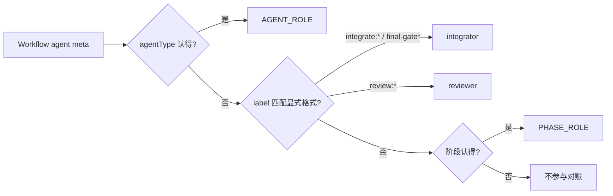

## Context

- **对账入口**：`session-decompose.py` 的 `workflow_agents`（`:171`）从 `<wf>/agent-*.meta.json` 取 `description`（即 label）、`workflowPhase`、`agentType`；`audit_routes`（`:209`）按 `AGENT_ROLE.get(atype) or PHASE_ROLE.get(phase)` 定角色（`:216`）。
- **label 的来源**：`opsx-apply.js` 派发时写入，五处，格式固定：

  | 行 | label | agentType（`typed(...)`） | 阶段 |
  |---|---|---|---|
  | `:153` | `S1` / `S1:retry` | slice-executor | Implement |
  | `:180` | `integrate:w1` / `integrate:w1:retry` | integrator | **Implement** |
  | `:189` | `review:S1` | code-reviewer | Review |
  | `:213` | `fix` / `fix:retry` | slice-executor | Fix |
  | `:235` | `final-gate` / `final-gate:retry` | integrator | Finalize |

  只有 `:180` 的阶段与角色对不上，这就是误判的唯一来源。
- **跨模块**：判定改用 label 后，`opsx-apply.js` 的 label 格式成为 `session-decompose.py` 依赖的接口，所以写本 design。

## Goals / Non-Goals

**Goals:**
- 没有 `agentType` 时，integrator / reviewer 按派发方写下的 label 判角色，消除误报与漏报。
- label 格式成为显式契约，由测试守住，任何一侧单改都会红。

**Non-Goals:**
- 不改 `opsx-apply.js`（不新增 meta 字段、不改 label）。
- 不改带 `agentType` 时的判定。
- 不处理回退用 Agent 派发路径的对账，也不处理仓库根是否注册 `template/.claude/agents`。

## Decisions

### D1 · 判定顺序：agentType → label → 阶段

- `agentType` 是派发方声明的角色，最可靠，保持第一。
- label 也是派发方写下的，比阶段更贴近角色：阶段是流程位置，integrator 恰好在 Implement 阶段派发。
- **否决：给 meta 新增 role 字段**。要改 `opsx-apply.js` 和 Workflow 运行时写 meta 的方式，后者不在本仓控制内。
- **否决：只改 `PHASE_ROLE`**。Implement 阶段同时有执行体和 integrator，按阶段无论怎么映射都会错一类。

### D2 · label 只认显式格式，其余退回按阶段（人类决定，2026-10-15）

- `^integrate:` 与 `^final-gate` → integrator；`^review:` → reviewer。
- 切片 id（任意字符串）和 `fix` 不登记格式：它们的阶段（Implement / Fix）本就判为 executor，结果一致。
- 不认识的 label 退回按阶段判，与改动前相同。将来脚本新增的 label 漏登记时，最坏只是退回今天的行为。
- 否决「不认识一律判 executor」：会把 Review / Finalize 阶段的未知 label 判错。否决「不认识不对账并告警」：会漏账，把告警当红又引入新误报。

### D3 · 契约用测试守住，两侧都要对上

- `tests/test_agents_workflow.py` 新增一条：
  - 读 `opsx-apply.js`，断言 integrator / reviewer 的 label 模板（`` `integrate:w${i + 1}` ``、`'final-gate'`、`` `review:${s}` ``）各自和对应的 `typed('integrator')` / `typed('code-reviewer')` 写在同一个派发调用里；
  - 加载 `session-decompose.py`，断言这些模板展开后的样例 label（含 `:retry` 变体）判出的角色与 agentType 对应的角色相同。
- 只改脚本的 label 或只改对账的格式，都会让这条测试红。

## Risks / Trade-offs

- [label 是字符串约定，不是类型] → D3 的契约测试两侧都校验；漏登记时退回按阶段，不会更差。
- [有人给切片起名 `review:x`] → 切片 id 由 `slices.json` 定，实际不会这样写；真出现时会被判成 reviewer，期望模型与 executor 相同（都是会话主模型），对账结果不变。
- [`description` 缺失] → `workflow_agents` 已用文件名兜底（`:192`），这类 label 不匹配任何格式，退回按阶段。

## Migration Plan

- 只改判定函数，输出格式与退出码不变；无数据迁移。
- 回滚：还原该函数即可，回到按阶段兜底。

## Open Questions

（无）
