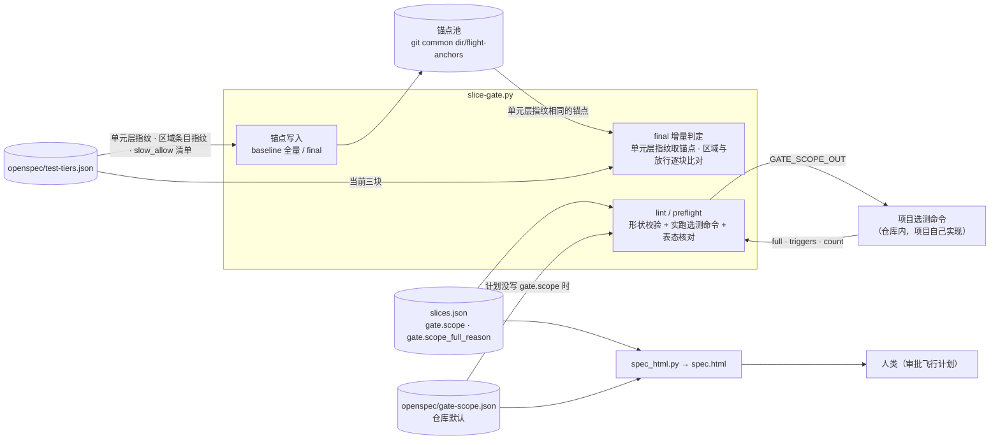

## Context

- **现状**（main `471aa98`，`template/.claude/hooks/slice-gate.py`）：
  - **锚点过滤**：`_anchor_candidates`（`:3967`）要求锚点的 `tiers_key` 与当前相等；`_tiers_key`（`:3982`）是整个 `test-tiers.json` 的 blob 哈希。baseline（`:3463`）与 final（`:3176`）写锚点时都带它。
  - **全局文件**：`GLOBAL_FILES`（`:3977`）含 `TIER_FILE`；`_full_why`（`:4106`）里 Δ 命中全局文件即全量，`gate.impacted` 路径同样检查；另有「Δ 含锚点时已存在、未被任何用例触及的非 Python 文件 → 全量」一条，`test-tiers.json` 也会命中它。
  - **同树沿用与 `gate.impacted` 锚点**：`_final_fps`（`:4010`）的 `tiers` 指纹也取 `_tiers_key`；`_impacted_anchor`（`:4076`）比对它。
  - **分层增量**（`:3066`）：选中文件按 `unit.paths` 挂探针；已选区域只在「选中文件落在区域 paths / 锚点没测过 / Δ 命中 covers」时运行。
  - **lint**：`lint_plan`（`:1939`）只做形状与仓库默认检查的核对，不运行命令（部件形态的 `list` 选择器除外）；`cmd_lint` 同时服务 `lint` 与 `waves`（`:4391`）；`cmd_preflight`（`:3530`）先调 `lint_plan`。
  - **审批页**：`spec_html.py` 的 `render_flight`（`:480`）渲染切片、scenario 与飞行记录，不渲染 gate 字段。
- **实证**（2026-11-02，临时仓库，用 `tests/test_final_tiers.py` 的 `tiers_repo`）：baseline 后只加一条 `slow_allow`、或只给区域 `covers` 加 glob，再改一行源码 → final `{"mode": "full", "full_why": "没有可用锚点"}`；对照组走增量（重跑 1 个文件、沿用 2 个用例、区域跳过）。
- **afa 实证**：见 proposal。afa 的选测（`tools/testgate` + `executor/tests/tiering_select.py`）是项目自己的代码。
- **用户决策**（2026-11-02，6 题全取推荐）：Q1 三块分别比对；Q2 `$GATE_SCOPE_OUT` 文件；Q3 `{触发项: 理由}` 键须与触发项一致；Q4 仓库级 `gate-scope.json`；Q5 lint 与 preflight 跑、waves 不跑、300 秒；Q6 失败即红。
- **约束**：
  - 铁律 9：判据由脚本取得——触发项来自选测命令的输出，lint 核对键，不靠模型转述；
  - 铁律 10：未配分层、未配选测命令时行为不变；
  - 在役 ADR `DRAFT-final-incremental-by-dependency-anchor` 决策 4 写明「分层文件变动 → 全量」：本 change 由新 ADR 只 supersede 这一项（D1–D4），原文件不改；
  - 在役 ADR `DRAFT-gate-evidence-not-self-reported`：新门禁先回答「判据从哪来、谁能伪造」（D10）。

C4 组件视图（plain Mermaid，沿用先例）：

- **边界**：A 全在 slice-gate.py 的锚点与 final 里；B 横跨 lint / preflight（判定）与 spec_html.py（展示），选测命令属于项目，模板只定契约、核对格式与表态。
- **假设**：选测命令能在 300 秒内只算范围不跑测试（afa 量级：收集 10698 个用例 9.5 秒）。
- **不确定**：选测命令报告的真伪模板无法核验（见 D10、Risks）。

## Goals / Non-Goals

**Goals:**
- apply 期改 `slow_allow`、改或新增区域不再让 final 退回全量；单元层改动仍全量。
- 项目自带选测退化为全选时，在 propose 的 lint 就被发现，并由人类在 spec.html 看着触发项与理由放行。
- 仓库声明一次选测命令，之后每个 change 都受保护，不靠模型记得。

**Non-Goals:**
- 修 afa 的 `tiering_select.py`，或为 afa 写范围报告子命令（afa 自己的 change）。
- `gate.impacted` 在 final 的退化、baseline / final 侧的范围记录。
- 部件形态（final 恒全量，不变）。
- 兼容旧格式锚点（升级后第一次 final 全量一次）。

## Decisions

**D1 分层指纹只取单元层（简写形态）**
- `_tiers_key` 对简写形态改为单元层的规范 JSON（`json.dumps(unit, sort_keys=True, ensure_ascii=False)`）的 sha1；部件形态仍取整文件 blob 哈希（其 final 恒全量，不受影响）；无分层 → `None`，不变。
- 锚点过滤、`_final_fps.tiers`、`_impacted_anchor` 都经它，自动换成新口径。分层文件新增或删除时，一方为 `None`，锚点照旧不可用。
- **否决**：继续用整文件哈希、只给 `slow_allow` 开白名单（Q1 的 B）——区域改动仍全量。

**D2 锚点记录区域条目指纹与放行清单**
- 有分层（简写形态）时，baseline 全量、final 全量与增量写的锚点都带 `tiers_detail`：`{"regions": {区域名: 条目规范 JSON 的 sha1}, "slow_allow": [用例 id，排序]}`。
- 增量 final 的新锚点按当前分层文件写 `tiers_detail`（本次已按当前名单判过选中文件）。

**D3 final 内建增量按块收窄**
- **区域**：`run_regions` 在现有三条件外再加一条——已选区域 R 当前条目指纹 ≠ 锚点 `tiers_detail.regions[R]`（锚点缺该项也算）。未选区域不进 `run_regions`，与现在相同。
- **放行**：当前 `slow_allow` 键集合与锚点 `slow_allow` 清单的对称差 → 取 `::` 前的文件，存在且落在 `unit.paths` 的并入选中集合（随后与其它选中文件一样挂探针、判 G10）。理由 / 批准文字不参与比较。
- 锚点缺 `tiers_detail`（理论上只有旧锚点，而旧锚点已被 D1 过滤掉）→ 区域按「缺记录」全跑、放行清单视为空，均偏保守。

**D4 Δ 中的分层文件不触发全量**
- `GLOBAL_FILES` 去掉 `TIER_FILE`；`_full_why` 的「未被任何用例触及的非 Python 文件」一条跳过 openspec 根的分层文件路径（由 `cmd_final` 算出仓库相对路径传入）。
- 安全性：单元层变化由 D1 拦（没有可用锚点 → 全量）；区域与放行由 D3 处理；其它目录下同名文件按普通非 Python 文件处理。

**D5 选测命令的来源与运行契约**
- 有效命令 = `gate.scope`（非空字符串）否则 `<openspec 根>/gate-scope.json` 的 `cmd`（文件只许 `cmd` 一个字段）。
- 运行：`cwd` = git 顶层，`subprocess.run(cmd, shell=True, timeout=SCOPE_TIMEOUT)`，`SCOPE_TIMEOUT = 300`（常量，不可配置）；环境变量 `GATE_SCOPE_OUT` 指向临时目录里的 `scope.json`，运行后读它。
- 报告形状：对象，只含 `full`（bool）、`triggers`（str 数组；`full` 为真时非空、每项非空）、`count`（可选，非负 int，bool 不算）。
- 失败（非 0、超时、无文件、非 JSON、形状不符）→ `scope:` 违规，写明退出码 / 超时 / 缺文件 / 哪个字段（Q6 失败即拦，与 afa `ScopeError`「算不出就抛错、不静默退回全量」同一取向）。
- **否决**：stdout 最后一行 JSON（日志会挤掉它，Q2 的 B）。

**D6 运行时机**
- `lint_plan(data, change_dir=None, run_scope=False)`：形状校验（`gate.scope`、`gate.scope_full_reason`、`gate-scope.json`）在有 `change_dir` 时恒做；实跑只在 `run_scope=True` 时。
- `cmd_lint` 传 `run_scope=(args.cmd == "lint")`，`waves` 不跑；`cmd_preflight` 传 `True`（起飞前的机械关口，模型跳过 lint 也躲不过）。
- 核对通过时 lint_plan 往 stderr 打一行摘要，如 `scope: 选测范围未全选（12 条）` / `scope: 选测范围全选（触发 a.json、b.py），已逐项写理由`；stdout 的 waves JSON 不变。

**D7 全选须逐项表态**
- `gate.scope_full_reason`：对象，键 → 非空字符串。核对：`full` 为真 → 键集合须等于 `triggers`（缺键点名缺的触发项并提示写理由或修选测；多键点名多出的）；`full` 为假 → 每个键都点名、提示删除；没有有效选测命令却写了它 → 违规。
- 与 `checks_skip`、`integration_skip` 同一「逐项表态」模式；触发项由命令给出，spec.html 显示的是机械事实。
- **否决**：一段自由文字（Q3 的 B，看不到触发项、无法核对过期）。

**D8 审批页显示选测范围**
- `render_flight` 在切片表之后加「选测范围」小节：选测命令原文与来源（「计划 gate.scope」/「仓库默认 gate-scope.json」），有 `gate.scope_full_reason` 时渲染「触发项 → 理由」表。只读文件，不运行命令。

**D9 不进 `plan_sha`**
- 两个字段不影响 baseline 的测试结论；改理由不应让基线过期。`plan_sha` 不取未列出的 gate 键，代码无需改动，用 guard scenario 锁住。

**D10 判据从哪来、谁能伪造**
- 触发项与 `full` 来自仓库内的选测命令（`gate.scope` 显示在 spec.html；`gate-scope.json` 在仓库里，PR diff 可见），lint 只核对计划的表态是否与之吻合。
- 模型能改的是计划里的 `gate.scope`：换成一个永远报 `full: false` 的命令可以绕过——但命令原文显示在审批页，人类批准前可见；仓库默认则只能经 PR 修改。
- 选测命令报告失真（实际全选却报 `false`）模板看不出，这是「项目自带选测」的固有边界，记入 Risks。

## Risks / Trade-offs

- [lint 变慢：配了选测命令的仓库，每次 lint / preflight 多跑一次] → 只在 lint 与 preflight 跑，waves 不跑；300 秒上限。
- [选测命令报告失真] → 模板无法核验；靠命令在仓库内可审、审批页显示命令原文。
- [区域 `paths` 改动只让该区域重跑，不追究被移出区域的文件] → 单元层 `paths` 未变时这些文件不会悄悄进单元层；不属于任何层的文件由切片门禁 G12 与 `/test-tiers check` 拦。
- [放行清单只按用例 id 比较] → 理由文字变化不影响判定结果，不重跑是正确的。
- [锚点格式变化，升级后第一次 final 全量一次] → 一次性代价；之后恢复增量。

## Migration Plan

- 模板升级后，已有仓库的锚点因 D1 指纹口径变化全部不可用，第一次 final 全量并写入新锚点，之后自动增量；无需人工操作。
- 想要 B 保护的仓库：实现一个只算范围的选测命令（遵守 D5 契约），在 openspec 根写 `gate-scope.json`。之后的 propose 若选测退化为全选，lint 会红并点名触发项。
- afa 跟进（afa 自己的 change，不在本 change）：① `tiering_select` 的登记表按条目差分；② testgate 增加输出 D5 报告的子命令并写 `gate-scope.json`。
- 回退：A 回退即恢复整文件哈希与 `GLOBAL_FILES`；B 是可选契约，删除 `gate-scope.json` / `gate.scope` 即回到现状（铁律 10）。

## Open Questions

- 无阻塞项。在役 ADR `DRAFT-final-incremental-by-dependency-anchor` 决策 4 的「分层文件」一项由本 change 的新 ADR supersede，原文件不改。
