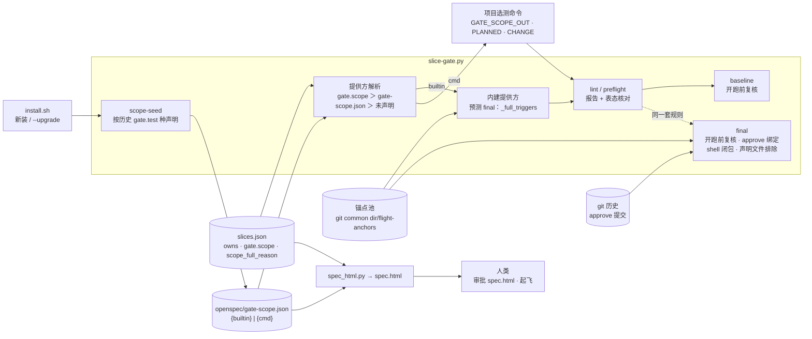
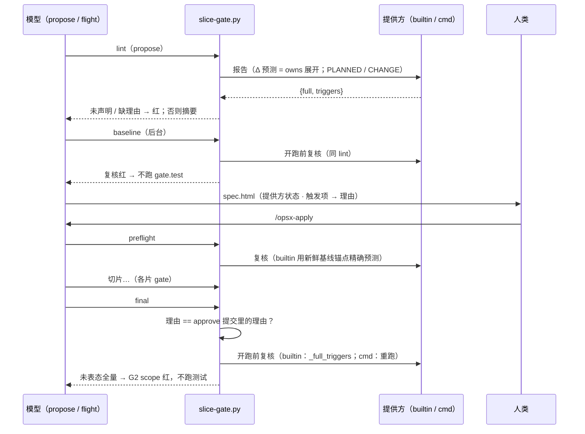

## Context

- **触发**：2026-11-07 afa `export-xlsx-aparam-override` 的 baseline 全量跑了 683.8 s。门禁范围是 11343 条，集成层全选；触发项是登记表 `executor/tests/tiering_registry.json` 与计划改动的 `executor/bin/*`。afa 的 `slice-gate.py` 已经带选测契约，但仓库没有 `gate-scope.json`，计划里也没有 `gate.scope`，所以 lint 静默跳过。
- **现状**（main `325adcf`，`template/.claude/hooks/slice-gate.py`）：
  - **声明解析**：`_scope_default`（`:1460`）只认 `{"cmd"}`；`_lint_scope`（`:1547`）在没有命令时 `return errors, None`（`:1566`）。
  - **运行契约**：`_run_scope`（`:1507`）只设 `GATE_SCOPE_OUT`（`:1511`）。
  - **baseline**：`cmd_baseline`（`:3380`）校验检查形状与分层后，直接写运行标记（`:3416`）并运行 `gate.test`，不复核范围。
  - **final 全量判定**：`_full_why`（`:4268`）按序返回第一条原因。「依赖图没见过的非 Python 文件」一条在 `:4294-4306`：
    - 依赖图 = 锚点 `deps` 的并集，来自 `open` 审计事件、子进程 argv、Python 子进程的 sitecustomize、静态 import 闭包；
    - bash 子进程读到的文件看不见；
    - 只排除了测试文件与分层文件（`tier_rel`）。
  - **选中**：`_final_select`（`:4311`）= 依赖与 Δ 相交 ∪ Δ 中的测试文件 ∪ 锚点失败 ∪ 盲文件。
  - **审批页**：`spec_html.render_scope`（`:480`）在没有命令时返回空串，什么也不显示。
  - **安装器**：`install.sh:382` 种子清单里没有 `gate-scope.json`。种子循环在安装与升级两种模式下都会跑，所以只要把它加进种子清单，就会给 afa 这类仓库误种 builtin。
- **实证与推断**：
  - 断点 1–4 读代码可确认；
  - 断点 5 由代码推出（审计钩子只在 Python 进程里生效），S2 的场景骨架会先验红作为实证；
  - afa 侧用只读脚本推演过 shell / 引用静态反查：252 个 bin 文件解析出 194 条引用边，只有 11 个文件没有任何用例引用。证据在 afa worktree `tiering-registry-entry-impact/openspec/superpower/2026-11-07-tiering-scope-no-false-full/evidence/`。
- **用户决策**（2026-11-07，决策页 Q1–Q9 全取推荐）：
  - Q1 模板根治，afa 侧单独接入；
  - Q2 未声明硬红，仅本 change 建立声明时放行；
  - Q3 builtin 配认不出的 `gate.test` 判红；
  - Q4 运行期守卫不跑、判红；
  - Q5 理由以 approve 提交为准；
  - Q6 工作流路径排除 + shell 闭包；
  - Q7 升级按历史判定是否种；
  - Q8 一个 change 四片；
  - Q9 与 afa 并行推进。
- **约束**：
  - 铁律 9：判据由脚本取得；
  - 铁律 10：回退必存在；
  - 在役 ADR `DRAFT-installer-versioned-with-template` 决策 2：安装器不得交互，新增参数只能可选；
  - 在役 ADR `DRAFT-gate-evidence-not-self-reported`：新门禁先回答「判据从哪来、谁能伪造」（D14）。

C4 组件视图（plain Mermaid，轻量 C4，沿用先例）：

动态视图（一个 change 的生命周期里，复核发生在哪里）：

- **边界**：
  - 提供方解析、内建预测、复核都在 `slice-gate.py`；
  - 审批页展示在 `spec_html.py`；
  - 种声明的判定在 `slice-gate.py scope-seed`，由 `install.sh` 调用模板自带的那一份；
  - 项目选测命令属于项目，模板只定契约。
- **假设**：
  - 切片只改 owns 内的文件（G 门禁保证），所以「owns 展开」能代表 final Δ；
  - cmd 提供方 300 秒内只算范围、不跑测试（afa 量级约 10 s）。
- **不确定**：cmd 提供方的报告真伪模板无法核验，沿用现行边界（D14）。

## Goals / Non-Goals

**Goals:**
- **I1**：每个 change 在 lint、preflight 都有一份范围报告，覆盖 baseline 与 final，包括计划要改的文件。
- **I2**：全选必须逐个触发项写理由，显示在审批页；「未声明」本身就红，不再静默。
- **I3**：baseline 与 final 开跑前机械复核，未表态的全选不跑、判红；批准后改理由无效。
- **I4**：工作流声明文件不会单独导致全量；被 source 的 shell 文件按依赖选中，不再触发全量。
- **I5**：新装与升级都由安装器种好声明；种不了的，醒目提示，并由 lint 兜底。

**Non-Goals:**
- **afa 的选测收窄**：登记表按条目比对、bin 引用索引、afa 的 cmd 提供方，属于 afa 自己的 change，与本 change 并行推进。
- **非 pytest 运行器与部件形态的增量 final**：它们恒全量，属于设计边界，只注明。
- **`gate.impacted` 的判定口径**：不变，但它同样受 final 复核约束。
- **其它语言子进程的读文件追踪**：node、make 等读到的文件仍按「没见过」处理，并会在计划期被点名。
- **cmd 提供方报告的真伪核验**。

## Decisions

**D1 声明形态与提供方解析（契约 v2）**
- `gate-scope.json` 是对象，恰含 `cmd`（非空字符串）或 `builtin`（`true`）之一。违规行：`scope: 仓库选测声明 … cmd 与 builtin 只能取其一` / `builtin 须为 true` / `有未知字段 …`。
- 解析：`gate.scope`（cmd，来源「计划 gate.scope」）> 文件（来源「仓库声明 gate-scope.json」）> 未声明。返回 `{"kind": "cmd"|"builtin"|None, "cmd", "source"}`，lint、baseline、final、spec.html 都用同一份解析结果，各处口径一致。
- **否决**：用 `{"cmd": "python3 .claude/hooks/slice-gate.py scope"}` 表示内建提供方。路径因仓库而异（本仓库在 `template/` 下），而且会白起一个子进程。

**D2 未声明判红，本 change 建立声明时放行**
- 只在实跑核对的路径里做：lint、preflight、baseline、final；`waves` 和 `lint_plan(run_scope=False)` 不做。
- 未声明，且 owns 不匹配 `<openspec 根>/gate-scope.json` → `scope: 未声明选测范围：在 <openspec 根>/gate-scope.json 写 {"builtin": true}（gate.test 是普通测试命令）或 {"cmd": "<只算范围的命令>"}（仓库自带选测）`。
- owns 匹配时，视为报告 `{"full": true, "triggers": ["scope:undeclared"]}`，交给现行的表态核对：缺理由就红，有理由就通过。摘要写「未声明选测范围，本 change 建立仓库选测声明（已写理由）」。
- 伪触发项用 `scope:` 前缀，与文件路径类触发项不会撞名。
- **否决**：不阻断，只在每个 change 写理由（Q2-B）。理由是模型写的，「静默」只是换成「套话」。

**D3 builtin 的 gate.test 识别**
- 满足任一条即可识别：
  - `_pytest_head(gate.test)` 非 None；
  - 是 test-tiers 驱动：解释器名以 `python` 开头、脚本名为 `test-tiers.py`、参数为 `run unit`；
  - 去掉首尾空白后等于 `npm test` / `go test ./...` / `cargo test`。
- 识别不了 → `scope: builtin 声明要求 gate.test 是可识别的普通测试命令（…），当前是 <cmd>：自带选测的仓库改用 {"cmd": …}`。
- 包装脚本如果恒跑全部，写一个恒报 `{"full": false, "triggers": []}` 的 cmd，并在审批页可见。
- **否决**：只在审批页提示（Q3-B）。afa 这类仓库误声明 builtin 后，baseline 退化仍然看不见。

**D4 契约新增两个环境变量**
- 在 `_run_scope` 里设置：
  - `GATE_SCOPE_PLANNED`：临时目录下 `planned.txt` 的路径，内容是各片 owns 按切片顺序去重，一行一条；
  - `GATE_SCOPE_CHANGE`：change 目录相对 git 顶层的路径。
- 两者在 lint、preflight、baseline、final 的每一次运行中都设置。
- **否决**：让提供方自己扫 `openspec/changes/*/slices.json`。多个 change 并存时它不知道当前是哪一个。

**D5 内建提供方：与 final 共用一套触发项规则**
- 新增 `_full_triggers(root, delta, anchor, baseline, gate, tier_rel, decl_rels, impacted)`，返回全部触发项列表。`_full_why` 改为调用它，取第一条拼人话，原有措辞不变。
- 触发项是稳定字符串：
  - 文件类用仓库相对路径，包括全局文件、依赖图没见过的非 Python 文件；
  - 其它类用代码：`final:no-anchor`、`final:baseline-missing-failed-nodes`、`final:gate-test-unreproducible`、`scope:undeclared`。
- 预测 Δ = `git ls-files` 中匹配任一 owns glob 的文件。lint / baseline 与 preflight 的差别：

  | | lint / baseline | preflight |
  |---|---|---|
  | 依赖图取自 | 锚点池里 `cmd_key` / `tiers_key` 匹配、`measured` 为真的最新锚点 | `_pick_anchor` 选出的锚点，通常是刚写的基线锚点 |
  | 取不到锚点时 | 不报「没见过」类触发项；预测 Δ 里现存的非 Python、非文档、非声明文件列为待定 `pending`，`_scope_reason_errors` 不把为它们预写的理由判多余；摘要注明「final 精确预测在 preflight」 | 报 `final:no-anchor` |
  | 基线缺 `failed_nodes` | 不检查 | 报 `final:baseline-missing-failed-nodes` |

- 非 pytest 的已识别运行器，或部件形态：报告不全选，摘要注明「final 恒全量（设计边界）」。
- 不在 git 仓库里（测试用的临时目录）：只做识别与全局文件检查，全局文件按 owns 条目的文件名判定，不取锚点、不展开 glob，以免内建提供方在库外崩溃。
- **否决**：在计划期用「锚点 vs 当前树」的 Δ 预测。池里的锚点可能很旧，Δ 会混进别的 change 的文件，误报多。

**D6 工作流声明文件不触发「没见过」全量（比决策页收窄）**
- 排除集合：
  - `<openspec 根>/gate-scope.json`、`<openspec 根>/gate-checks.json`；
  - 现有的 `<openspec 根>/test-tiers.json`；
  - git 顶层 `.claude/**`。
- 全局文件规则照旧。若有测试真触及这些文件，照常按依赖选中。
- **为什么不排除整个 `openspec/**`**（决策页 §5 写的是 `openspec/**`）：本仓库的 `template/openspec/` 既是工作区，又是安装种子。`install.sh` 用 bash 子进程拷贝 `config.yaml`、`schemas/**`，测试测不到这条依赖；整个排除的话，改种子会漏跑 `tests/test_install.py`。只排除只被门禁或 Claude Code 读取的声明文件，才不会漏选。
- **否决**：整个排除 `openspec/**`，理由如上。

**D7 shell 静态闭包**
- 新增 `_shell_closure(root, files) -> set`：从 `files` 里的 shell 脚本出发，按 spec 规则解析，返回新到达的仓库文件集合（不含输入本身），可以递归。
- 实现要点：
  - 逐行跳过注释；
  - 先把 dirname 形态和由其赋值的变量替换为脚本所在目录的绝对路径；
  - 切出路径记号，按脚本目录、再按 git 顶层解析；
  - 文件名含 `$` 时，对解析出的目录取同后缀的全部文件。
- 用在三处：
  - `_final_select`：对每个测试文件，`deps ∪ closure(deps)` 与 Δ 相交即选中；
  - `_full_triggers`：「见过的文件」= 全部 deps ∪ closure；
  - D5 的内建预测：同 `_full_triggers`。
- 闭包在当前树上计算。如果脚本本身改了，脚本已经在 deps 里，对应测试照样被选中。
- 解析不到的引用不补依赖，现行规则照旧（全量），并会在计划期被点名，宁多勿漏。

**D8 baseline 开跑前复核**
- `cmd_baseline` 在现有形状校验之后、写运行标记之前，调用与 lint 相同的 `_lint_scope(gate, change_dir, run_scope=True)`，失败 → `die("选测范围复核未过（baseline 不运行）：…")`。
- 不写运行标记，不碰现有 `gate-baseline.json`。

**D9 final 开跑前复核**
- 位置：`cmd_final` 算出 `why` 之后、运行任何测试之前；G7 红时本来就不跑测试，也就不复核。
- 内建：`why` 非空且不是 `--full` 时，取 `_full_triggers`，`未批准 = 触发项 − 已批准键`。
- cmd：重跑提供方（环境同 D4），全选时 `未批准 = triggers − 已批准键`；提供方失败也判红。
- 未声明：同 D2。
- 不通过 → `failed.append("G2 scope：…")`，跳过测试运行，final 红，结果带 `scope` 段 `{kind, full, triggers, unapproved}`。
- `--full` 豁免：它是显式要求，只会多跑。

**D10 理由以 approve 提交为准**
- 用 `git log -G "\tapprove\t" --format=%H -n 1 -- <change>/timeline.md` 找最近一次新增 approve 行的提交，读该提交的 `<change>/slices.json` 里的 `gate.scope_full_reason`（缺省为 `{}`）。
- final 复核时，当前理由与之不等 → `G2 scope：gate.scope_full_reason 在批准后被修改（批准时 …；当前 …）`。
- 找不到 approve 提交 → 以当前计划为准。
- 理由仍不进 `plan_sha`（现行 ADR 决策 7），改理由不会让基线过期，但会被 final 拦下。重新批准会产生新的 approve 提交，也就重新绑定。

**D11 安装器：scope-seed**
- `slice-gate.py scope-seed --openspec-root DIR`，行为见 spec。识别用 D3 的同一函数，单一出处。
- `install.sh` 在种子循环之后、两种模式下都执行 `python3 "$TEMPLATE_SRC/.claude/hooks/slice-gate.py" scope-seed --openspec-root "$TARGET/openspec"`：
  - 用模板自带那一份，不受目标里旧脚本的影响；
  - 输出逐行以 `[scope]` 前缀打印；
  - 「已种」计入 add。
- 缺 python3 → 打印手动声明的指引。不新增参数，不交互。
- **否决**：
  - 把 `gate-scope.json` 加进种子清单：升级时也会给 afa 种 builtin；
  - 在 bash 里重写识别逻辑：会与 Python 漂移。

**D12 测试基座与本 change 自身**
- `tests/conftest.py` 的 `git_repo` 在初始提交里带 `openspec/gate-scope.json`：`{"cmd": "printf '{\"full\": false, \"triggers\": []}' > \"$GATE_SCOPE_OUT\""}`。
  - 这是恒报未全选的 cmd，只起一次 sh，开销小；
  - 既有用例因此保持原有语义，「未声明」与「builtin」由新用例显式覆盖。
- 不用 `git_repo`、直接在临时目录跑 lint 的用例（`test_slice_gate.py` 6 条、`test_tiers_plan.py` 8 条、`test_gate_checks_lint.py` 6 条）改为带 `{"builtin": true}`，builtin 在库外只做静态检查。推荐做法是：`test_slice_gate.write_plan` 在 change 目录位于 `<根>/changes/` 下、且根上没有声明时补写 builtin；不走 `write_plan` 的文件在各自 helper 里补。需要测「未声明」的用例在写计划之后再删声明。
- ⚠ `conftest.py` 是全局文件，本 change 自己的 final 必然全量；而本 change 的 lint、baseline 跑在旧代码上，旧代码不认 builtin。因此计划写 `gate.scope` 为静态声明 `printf '{"full": true, "triggers": ["tests/conftest.py"]}' > "$GATE_SCOPE_OUT"`，并在 `gate.scope_full_reason` 写理由。
  - 旧代码 lint 会运行它并核对理由；新代码 final 复核会重跑它，与批准的理由对得上；
  - 命令原文显示在审批页。S4 会落地 `template/openspec/gate-scope.json` = `{"builtin": true}`，此后本仓库的新 change 改由内建提供方保护。

**D13 审批页恒显示提供方状态**
- `render_scope` 改为调用与 D1 同一口径的只读解析（`spec_html.py` 自带一份小函数，不 import slice-gate），恒输出小节：
  - cmd → 命令原文与来源；
  - builtin → 「模板内建（builtin）」与来源；
  - 未声明 → `
未声明选测范围
`，owns 匹配声明文件时再加「本 change 建立仓库选测声明」。
- 有理由时照旧输出表格。

**D14 判据从哪来、谁能伪造**
- **builtin**：触发项由脚本按锚点依赖图、owns、全局文件清单算出，模型改不了算法。模型能改的是 owns（缩小 owns 会让切片门禁 G 拦下越界改动）和声明本身（改动可见于 diff 与审批页）。
- **cmd**：沿用现行边界，命令在仓库内可审，原文显示在审批页。
- **理由**：批准后再改会被 D10 拦下，必须重新批准。
- **`--full`**：只会多跑，不构成绕过。

**D15 顺带修既有不稳定用例（用户 2026-11-07 授权在起飞前、propose 期完成）**
- **现象**：本 change 前三次基线都红在 verify 单独重跑的那一遍。
  - 第一次：S1 verify 是全量命令，基线推导不了，单独再跑一遍全量，`tests/test_final_tiers.py::test_tiers_region_runs_when_selected_file_in_region` 失败；同一棵树的 `gate.test` 全量是绿的。
  - 第二次：`gate.test` 全量本身挂了这一条（记为预存红），S1 verify 又红。
  - 第三次：S1、S2 verify 已排除这一条，同文件的 `test_tiers_region_runs_when_anchor_never_tested_it` 又在 S2 verify 里挂了。
  - 未改动的 main 上单跑同样会失败；修复前 worktree 内连跑 3 次，失败 2 次。
- **根因**：两条用例都在 baseline 后立刻做等长改写：`assert h.H == 1` → `assert h.H == 2`，`H = 1` → `H = 2`。pytest 断言改写缓存与 Python 字节码缓存都只比较「源文件修改时间（秒）+ 大小」，同一秒内的等长改写会命中旧缓存，旧代码照样运行，final 误绿。
- **修法**：`tests/final_helpers.py::change_and_commit` 写完后，用 `os.utime` 把该文件的修改时间设为「写入后的时间 + 2 秒」，再提交。只改「baseline 之后的改写」这一个入口，不改 `conftest.write`。
- **锁住与验证**：新增 `tests/test_final_helpers.py::test_change_and_commit_moves_mtime_past_cache_window`，先写、先验红（改写后修改时间只晚 0.03 秒），修复后转绿。两条原本不稳定的用例修复后各连跑 5 次，全部通过。
- **为什么在起飞前修**：基线跑在当前树上，修复若排在 S1，基线就一直在跑未修的代码，排除一条又冒一条。用户在三个方案里选了「授权在 propose 期先修」。修复只碰测试基座，不碰产品代码。S1 因此不再 own `tests/final_helpers.py` / `tests/test_final_helpers.py`，S1、S2 的 verify 也不再需要排除项。
- **否决**：
  - 修复留在 S1、基线期间在 verify 里排除：第三次基线证明排不干净；
  - 先单独开 mini change 修到 main：要多一轮提 PR、合并、跟进 main，而本仓库没有别的在飞 change 能从中受益；
  - 只把 S1 verify 改成测试文件列表：治不了不稳定本身；
  - 设 `PYTHONDONTWRITEBYTECODE`：要改所有被测仓库的 `gate.test`，侵入更大，而且不覆盖已有的缓存。

## Risks / Trade-offs

- **[升级后、接入前的自带选测仓库被卡住]** → 安装摘要写清怎么接；恒全量的包装一行就能声明；afa 按 Q9-A 先接入再升级。
- **[builtin 识别靠命令形态]** → 带选测插件的 pytest（如 `--testmon`）会被当成普通命令。文档写明：builtin 等于承诺 `gate.test` 不自带选测，声明可见于审批页。
- **[shell 静态解析认不全]** → 只会少补依赖，退回现行规则（全量），并在计划期被点名；不会漏选。
- **[预测与实际不一致]** → owns 是写入上限，预测偏保守；preflight 用新鲜锚点再算一次；final 复核兜底，真不一致时停下判红，不先付出全量的代价。
- **[飞行中途因 D9 停下]** → 只在计划期预测错了才会发生，属于例外；红了按「门禁红不收口」处理。
- **[测试基座改 conftest.py]** → 本 change 自己的 final 全量；已在计划中声明，并且本 change 改的是 `slice-gate.py`，增量本来也近乎全选。
- **[每次 lint / preflight / baseline / final 多一次范围计算]** → builtin 在进程内算；cmd 只算范围，afa 量级约 10 s。

## Migration Plan

- **合入后**：新装仓库自动受保护；已装仓库执行 `install.sh --upgrade`，按历史判定种 builtin 或得到醒目提示。
- **afa**：并行推进 afa 自己的接入 change，内容是 cmd 提供方（读取 `GATE_SCOPE_PLANNED`）加选测收窄。两者都合入后再升级 afa，这样新 change 不会被判红卡住。afa 里在飞的 change 用的是各自分支里的旧 `.claude`，不受影响。
- **本仓库**：S4 落地 `template/openspec/gate-scope.json` = `{"builtin": true}`。
- **回退**：revert 本 change，回到「契约可选、没声明就静默」的现状。仓库删掉 `gate-scope.json` 会直接判红，这是有意的：回退必须显式（铁律 10）。

## Open Questions

- 无阻塞项。在役 ADR 中，以下决策由本 change 的两份新 ADR 部分 supersede，原文件不改：
  - `DRAFT-repo-selector-reports-scope-at-plan-time` 的决策 1（可选 → 必有）、2（环境变量）、3（时机）、5（未声明的处理）；决策 7 不变，另加 approve 绑定；
  - `DRAFT-final-incremental-by-dependency-anchor` 决策 4 的「依赖图从未见过的非 Python 文件」一项（分层文件一项早已由 `DRAFT-tier-file-diffed-by-entry-in-final` 取代）。
