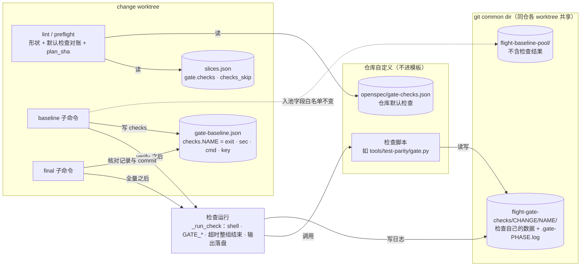

## Context

- **现状**（本仓 main `766d3fa`，`template/.claude/hooks/slice-gate.py`）：
  - `lint_plan(data)`（`:331`）只校验切片与 `gate.test`，拿不到 change 目录；调用方 `cmd_lint`（`:887`）与 `cmd_preflight`（`:1479`）。
  - `plan_sha`（`:241`）哈希 `[test, lint, typecheck, [[id, verify]]]`。
  - `cmd_baseline`（`:1300`）次序：候选复用 → 全量 → lint / typecheck（D10 沿用，`:1355-1372`）→ 每片 verify（`:1383-1396`）→ 运行期间改动判定 D6（`:1397-1405`）→ 写回耗时、入池（`:1429-1431`，字段白名单）→ 写 `gate-baseline.json`。
  - `cmd_final`（`:1255`）次序：G7 → lint / typecheck → G7 绿才跑全量；G7 红时 warning「G2 全量未跑」（`:1276-1277`）。
  - `run_cmd_full`（`:148`）经 shell 执行，没有超时、不能注入环境变量。带超时、整组结束进程的先例是 G7 实跑 `_pytest_outcomes`（`:775-790`）。
  - 基线池在 git common dir 下（`_pool_dir`，`:1708`），同仓各 worktree 共享。
  - 失败编号 G0–G8 已用，G9 空闲。
- **调用方**：`/opsx-propose` 第 5 步后台跑 baseline；`/opsx-apply` 第 3 步跑 preflight，收口跑 final；`/opsx-verify` 可以不经 preflight 直接跑 final；`ship` 只读 final 结论。
- **来源**：afa 的跨仓提案（见 proposal）。afa 会放两项检查：`coverage-parity`（merge-base 与分支头各量一次覆盖，按搬家映射对齐，丢失行 ≠ 0 即红）与 `shared-pkg-linkage`（碰 `packages/` 才在另一个子项目环境跑回归）。两者的脚本都留在 afa，不进模板。
- **用户决策（2026-10-17，评审页 Q1–Q6 全取推荐）**：见 proposal。
- **约束**：
  - 铁律 5（门禁红不收口）、铁律 9（零 token 判定）、铁律 10（未配置时行为不变即回退）；
  - ADR `DRAFT-gate-evidence-not-self-reported`：新门禁要先回答「判据从哪来、谁能伪造」（见 D11）；
  - ADR `DRAFT-baseline-reuse-by-content-fingerprint`：沿用只限本 change 旧基线、严格差异（本 change 照搬，D6）；
  - ADR `DRAFT-test-gate-baseline-diff`：全量的预存红差分口径不变，检查不参与。

C4 组件视图（轻量，`slice-gate.py` 内部；格式与先例 `baseline-incremental-reuse` 相同，用 plain Mermaid；本 change 新增的是「检查运行」组件和共用目录）：

- **边界**：模板负责「何时跑、带什么环境、看退出码、留日志」；测什么、怎么比较全在仓库脚本里。
- **关键关系**：baseline 与 final 通过共用目录交接数据，通过 `gate-baseline.json` 的 `commit` 对齐基准。
- **假设**：检查脚本自己决定量哪个 commit（如 afa 自己算 merge-base），`GATE_BASE_COMMIT` 只是给它的参考。
- **开放问题**：共用目录的回收（见 Open Questions）。

## Goals / Non-Goals

**Goals:**
- 给仓库一个「baseline 跑一次、final 跑一次、只看退出码」的成对检查扩展点。
- 检查红时基线红、final 红，与现有门禁一样不收口。
- 仓库能声明默认检查，规划时漏写由 lint 拦下，不靠模型记得。
- 未配置时行为、输出、`plan_sha` 与本 change 之前一致。

**Non-Goals:**
- 模板不解析检查的输出、不做任何覆盖测量或子项目回归。
- 切片门禁（每片 G1–G8）不跑检查。
- 不做隐式合并：仓库默认检查不会自动加进计划，必须在每个 change 里显式写出或写理由跳过。
- 不给检查设默认超时。
- 不回收共用目录。

## Decisions

### D1 配置形状与 lint 规则
- **形状**：`gate.checks = [{name, baseline?, final, timeout_sec?}]`，`gate.checks_skip = {name: 理由}`。
- **lint**：规则见 spec 第一条 Requirement；每条违规以 `checks:` 开头，进 `lint_plan` 的 `errors`，与现有规则一起报。
- **不认识的字段报错**：写成 `base_line` 这类笔误时，检查会静默变成「只有 final」，基线不跑。宁可让 lint 红。
- **`name` 限制为 `[a-z0-9-]+`**：它要当目录名，这样排除了路径穿越与大小写不敏感文件系统上的撞名。
- **否决**：校验命令能否切词——命令经 shell 执行，切词规则与 shlex 不同，校验反而会误拒。

### D2 检查运行函数
- 新增 `_run_check(cmd, root, env, timeout)`：`Popen(cmd, shell=True, cwd=root, env=env, stdout=PIPE, stderr=STDOUT, start_new_session=True)`，`communicate(timeout=timeout)`；超时时 `os.killpg(p.pid, 9)` 后再 `communicate()` 收尾。返回 `(rc, out, sec, timed_out)`。
- **为什么整组结束**：检查通常是包装脚本，脚本的子进程会占住输出管道；只结束 shell，`communicate` 会一直等。做法照 G7 实跑（`:775-790`）。
- **否决**：复用 `run_cmd_full`——它不能注入环境变量也没有超时；给它加参数会改到 lint / typecheck 的调用。

### D3 共用目录：位置与生命周期
- **位置**：`<git common dir 的绝对路径>/flight-gate-checks/<change>/<name>/`，`<change>` 是 change 目录名。与基线池同一处（`_pool_dir` 的解析方式），同仓各 worktree 可见，不在工作树里，不进 commit，也不会被 D6 当成运行期间改动。
- **baseline 实跑前清空再建**（用户决策 Q4）：final 读到的一定是最近一次基线写的数据。沿用时不清空。
- **final 只建不清**：目录不存在时创建（只有 final 的检查第一次运行时）。
- **否决**：
  - 只创建不清理——检查脚本某次没写出文件却退出 0 时，final 会读到上一次基线的数据，可能误判为绿；
  - 放 change 目录——覆盖数据可能很大，会被提交，也会被 D6 判成运行期间改动。

### D4 输出：完整日志落盘 + 末尾 20 行
- 每次运行把完整输出覆盖写到 `$GATE_CHECK_DIR/.gate-<phase>.log`（用户决策 Q5）。文件名以点开头，作为保留名写进契约，避免与检查脚本自己的文件撞名。
- 红时的 `reasons` / `failed` 项：首行写结论与日志路径，后面接输出末尾 20 行（`_tail(out, 20)`）。`gate-report.md` 照旧把换行压成一格。
- 写日志失败（OSError）不改变判定，提示里写「日志未能写入：<错误>」。

### D5 baseline：次序、环境与记录
- **次序**：每片 verify 之后、D6 的结束快照之前。检查若在工作树里写了文件，照 D6 的规则处理（新出现的未跟踪文件只警告，改了已跟踪文件判红）。
- **环境**：`GATE_PHASE=baseline`、`GATE_CHANGE=<change>`、`GATE_BASE_COMMIT=bl["commit"]`（本次基线开跑时的 HEAD）、`GATE_CHECK_DIR`。
- **记录**：`bl["checks"][name] = {exit, sec, cmd, key}`；超时另记 `timed_out: true`。`gate.checks` 非空时才有 `bl["checks"]`。
- **红**：`reasons` 加「check <name> 在基线上红（exit N）；日志 <路径>」或「check <name> 在基线上超时（N 秒）；日志 <路径>」，后接末尾 20 行。
- **基线池**：入池按字段白名单挑（`:1430`），天然不含 `checks`，池代码不改。

### D6 沿用：完全照 lint / typecheck 的 D10，另加目录仍在
- 条件：`hit is not None`、`src is own`、`strict_delta == []`、旧记录有 `exit` 且 `cmd`、`key` 都与当前相同、`GATE_CHECK_DIR` 存在。
- 满足 → `{exit, sec, cmd, key, reused: true}`，不运行、不清空。
- **旧记录的 exit 必为 0**：本 change 旧基线要当候选，`_try_reuse` 先要求候选 `ok is True`；检查红会让基线 `ok` 为 false，所以能走到沿用的旧记录都是绿的，不用另判。
- **为什么要求目录仍在**：目录被人删了还沿用，final 会读不到数据。实跑一次成本可接受。
- **否决**：
  - 永不沿用——只改计划文件重跑 baseline 时，afa 的覆盖对拍要再等一小时；
  - 跨 change 沿用——池不存检查结果，检查测的又常是本 change 的代码树与它自己的目录。

### D7 preflight：并入 plan_sha
- `plan_sha` 在 `gate.checks` 非空时，在原 `key` 列表末尾追加 `[[name, baseline], …]`（按配置顺序）；为空或缺省时不追加，旧计划的 sha 不变（用户决策 Q2）。
- 效果：加 / 删检查、改 `baseline` 命令 → 「基线过期」；检查在基线上红 → 「基线红」；baseline 运行期间改了检查的 baseline 命令 → 现有的「基线运行期间 gate / verify 被修改」（`:1417`）。
- 只改 `final` 或 `timeout_sec` 不让基线过期：基线测的东西没变。
- **否决**：照提案 §2.4 在 preflight 逐项核对——与 plan_sha 的判定重叠，多一段要维护的代码。

### D8 final：G9
- **位置**：G7 绿时，在全量 `gate.test` 判定之后；全量红也照跑，一次看全（提案 §5）。
- **核对基线**：每个检查都要 `baseline` 有 `commit`（否则 `GATE_BASE_COMMIT` 无从给）；`baseline` 非空的检查还要有同名记录、`exit == 0`、`cmd` 等于当前命令。不满足 → `G9 check <name>：基线缺记录或与计划不符，重跑 baseline`，不运行。`/opsx-verify` 可以不经 preflight 直接跑 final，这里不能假设 preflight 拦过。
- **运行**：环境 `GATE_PHASE=final`、`GATE_BASE_COMMIT=baseline["commit"]`；非 0 → `G9 check <name>：exit N；日志 <路径>` + 末尾 20 行；超时 → `G9 check <name>：超时 N 秒；日志 <路径>` + 末尾 20 行。
- **G7 红**：不跑；原「G2 全量未跑」提示不变，另加「G9 检查未跑：G7 已红，scenario 全绿后重跑 final」。
- `ship` 读 final 的 ok，不用改。

### D9 仓库默认检查文件
- 路径：`os.path.join(os.path.dirname(os.path.dirname(os.path.abspath(change_dir))), "gate-checks.json")`，即 openspec 根目录（用户决策 Q3）。安装后的仓库得到 `openspec/gate-checks.json`，本仓库得到 `template/openspec/gate-checks.json`。
- `lint_plan(data, change_dir=None)`：`change_dir` 为 None 时不读默认文件（保持现有直接调用方的行为）；`cmd_lint` 与 `cmd_preflight` 传入。
- 文件读不出、不是数组、元素不是带合法 `name` 的对象、`name` 重复 → lint 红（fail-closed：默认检查的意义就是防漏写，读不出不能当没有）。
- 只对账 `name`，不比较命令：各 change 可以按需改命令。
- schema 的 tasks instruction 加一句：仓库有默认检查时抄进 `gate.checks`，或在 `checks_skip` 写理由。

### D10 命名
- 照提案：`gate.checks` / `gate.checks_skip` / `GATE_PHASE` · `GATE_CHANGE` · `GATE_BASE_COMMIT` · `GATE_CHECK_DIR` / `flight-gate-checks` / G9（用户决策 Q6）。
- `GATE_*` 是给仓库脚本的对外契约，与模板内部用的 `FLIGHT_G7_*` 区分开。

### D11 判据从哪来、谁能伪造（ADR DRAFT-gate-evidence-not-self-reported）
- **判据**：检查命令的退出码，由 slice-gate 自己运行取得，不读任何模型叙述。
- **命令来源**：人类审批过的 `slices.json`；改了 `baseline` 命令会让基线过期（D7）。
- **谁能改弱**：检查脚本在仓库里时，执行体改它会被 G6 所有权拦下，除非计划把它划进某片 `owns`——那是人批准的，评审要看。这与 `gate.test` 指向仓内脚本时的信任模型相同。
- **判定不出时**：基线缺记录 → final 红（D8）；默认文件读不出 → lint 红（D9）；都是 fail-closed。

## Risks / Trade-offs

- [检查测的是仓外状态（数据仓指纹等），沿用看不出仓外变化] → 与 lint / typecheck 一样用 `baseline --full`；文档写明。
- [检查脚本被划进切片 `owns` 后可能被改弱] → 计划审批时可见；建议门禁脚本不与被它守护的改动放进同一个 change。afa 的 S0 要落地这两份脚本，S0 自己只能把检查放进 `checks_skip`，从 S1 起再启用。
- [共用目录没有回收，覆盖数据会在 `.git` 下累积] → 每个检查只保留最近一次基线的数据（D3 清空）；按 change 分目录，人可以按 change 名手动删除。记入 Open Questions。
- [检查一跑一小时，baseline 在后台跑得更久] → preflight 已能识别「基线仍在跑」；沿用（D6）避免只改计划时重跑。
- [检查在工作树里写文件] → 走 D6 的既有规则；契约里建议写进 `GATE_CHECK_DIR`。

## Migration Plan

- 纯增量：现有计划不写 `gate.checks` 就不受影响；现有 `gate-baseline.json` 照常可读。
- 回退：删掉计划里的 `gate.checks` 与仓库默认文件，行为即回到本 change 之前（铁律 10）。
- afa 侧：等本 change 合入并 `install.sh --upgrade` 后，在 afa 放 `openspec/gate-checks.json` 与两份脚本。

## Open Questions

- 共用目录的回收是否由 `/opsx-archive` 负责（删除 `flight-gate-checks/<change>/`）？本 change 不做，留待需要时另立 change。
- 没有在役 ADR 需要 supersede。
