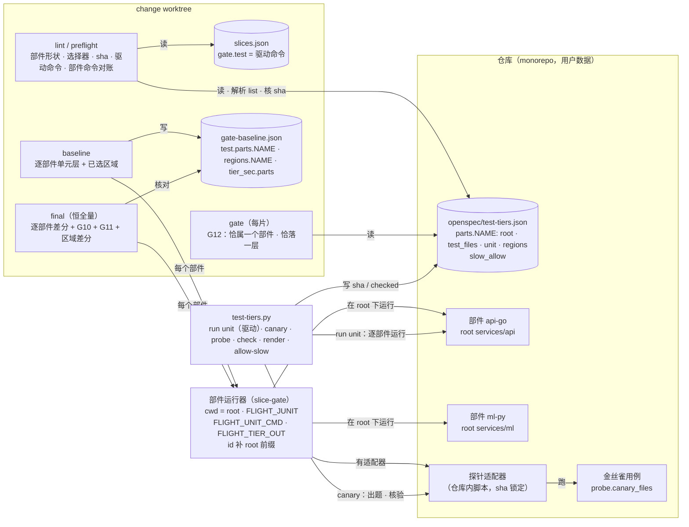

## Context

- **现状**（main `7a38afc`，`template/.claude/hooks/slice-gate.py`）：
  - 分层文件 `_load_tiers_file`（`:1264`）只认 `{unit, regions, slow_allow}`。`_lint_tiers`（`:1358`）要求 `gate.test == unit.cmd`。`tiers_matching`（`:1317`）按路径 glob 归层。
  - `run_test_gate(cmd, root, probe, deps)`（`:920`）有三个特点：
    - `cwd=root` 固定为 git 顶层；
    - 经 `PYTEST_ADDOPTS` 注入 junit、防护插件、探针；
    - 可度量要求输出恰好一行 pytest 汇总（`:986`）。
  - 探针插件 `TIER_PROBE_PLUGIN`（`:622`）写 `{nodeid, sec, hits}`。nodeid 相对 pytest rootdir。`_read_probe`（`:778`）读它。
  - G10 / G11：
    - 纯函数 `tier_verdicts`（`:1105`）；
    - 慢候选用 `_tier_rerun`（`:1937`）按 nodeid、以 G7 前缀、`--rootdir` 顶层单独重跑。
  - baseline（`:2694`）：有分层时恒全量；单元层带探针，判 G10 / G11；已选区域逐个跑并记 `regions.NAME`；`tier_sec`。
  - final（`:2437`）：
    - G7 绿后才跑后续；
    - 有三条路径：内建增量（锚点 + 依赖图，`:2519`）、`gate.impacted`、全量；
    - 区域按基线差分，`tier_sec`。
  - preflight（`:2977`）逐个核对已选区域命令。
  - G12（`:2330`）用 `TEST_FILE_RE` 认测试文件。`TEST_FILE_RE`（`:96`）只认 `test_*.py` / `*_test.py` / `*.test.*` / `*.spec.*`。
  - `test-tiers.py`：子命令 `probe` / `check` / `allow-slow` / `render`。按路径加载 slice-gate 与 takeoff-gate。
- **用户决策**（2026-10-29，两轮 8 项全取推荐）：见 proposal。
- **约束**：
  - 铁律 3 / 9：判据由脚本取得；
  - 铁律 5：门禁红不收口；
  - 铁律 10：未配置与简写形态行为不变即回退；
  - ADR `DRAFT-gate-evidence-not-self-reported`：新门禁先回答「判据从哪来、谁能伪造」（D9）；
  - ADR `DRAFT-test-tiers-unit-baseline-by-audit-probe`：单元层是基线、探针机械判定。本 change 把它推广到多部件、多语言，不推翻（D10）。

C4 组件视图（plain Mermaid，沿用先例）：

- **边界**：
  - 模板负责：部件怎么声明与校验、每个部件怎么运行和取证、两种契约（junit、探针适配器）的格式与自检、门禁怎么逐部件判；
  - 仓库与 `/test-tiers` 的 agent 负责：部件怎么划、每个部件用什么命令和适配器。
- **关键关系**：
  - `gate.test` 在部件形态下是固定的驱动命令。它进 `plan_sha`，但门禁不实际执行它，而是逐部件运行；
  - 部件命令改动由 preflight / final 与基线记录对账，与区域命令同一办法。

## Goals / Non-Goals

**Goals:**
- 一份分层文件描述多语言 monorepo：每个子项目 × runner 是一个部件，各有单元层与区域。
- 全仓单元层 = 各部件单元层之并，有一条人与 CI 都能跑的命令（驱动）。
- 门禁逐部件运行、逐部件判定。pytest 部件保留逐条差分与内置探针。
- 非 pytest 部件的 G10 有 junit 耗时可判。G11 有适配器可判，适配器经金丝雀自检、哈希锁定。
- 坐标统一相对 git 顶层：`owns` / `covers` / `scenario_tests` / `slow_allow` 与 runner 输出对得上。
- 测试文件「恰属一个部件、恰落一层」由 `check` 与 G12 机械校验。
- 简写形态与无分层文件时行为、输出、`plan_sha` 不变。

**Non-Goals:**
- 不做非 pytest 部件的失败差分（junit 差分是后续 change，Q5）。
- 不做部件形态下的增量 final（依赖图语言通用化是后续 change，Q5）。
- 不让 G7 实跑非 pytest scenario 测试（后续 change，Q5）。
- 不提供任何语言的现成适配器，由 `/test-tiers` 的 agent 按仓库调研实测后写。
- 不按 `covers` 选择性跑部件（M3 选了全跑）。

## Decisions

### D1 两种形态：简写不变，新能力只在部件形态
- **判别**：顶层有 `parts` 就是部件形态，否则是简写形态。同时出现 `parts` 与 `unit` / `regions` → lint 红。
- **简写形态**：字段集、校验、`gate.test == unit.cmd`、全部门禁代码路径（含增量 final、逐 nodeid 重跑）**原样不动**。新字段（`list` / `junit` / `probe` / `test_files` / `root`）写进简写形态，按现有「未知字段」报错。
- **部件形态**：顶层只含 `parts`、`slow_allow`。`parts` 是非空对象，部件名 `[a-z0-9-]+`。部件只含 `root`、`test_files`（可选）、`unit`、`regions`（可选）。
- **为什么不把简写在内部规范化成部件、走同一路径**：那样简写仓库会失去增量 final 与逐 nodeid 重跑（部件形态都不支持），属于行为变化。两条路径的代价是代码多一个分支，换来既有用户零变化（铁律 10）。
- **否决**：每个子项目一份分层文件、库递归发现（M1-B）。跨子项目的 change 要合并多份，区域名唯一与不重不漏都得跨文件校验。
- **否决**：仍一个单元层、由 agent 写聚合脚本（M1-C）。先后跑多个 pytest 会被判不可度量，库也无法逐部件判。

### D2 坐标系与 root
- **一律相对 git 顶层**：`root`、`test_files`、`paths`、`covers`、`scenario_tests`、`owns`、`slow_allow` 键、门禁文本里的用例 id，都相对顶层。
- **`root`**：
  - 非空、相对路径、规范化后不含 `..` 段、不以 `/` 开头，`.` 表示顶层；
  - lint 校验它是顶层下存在的目录；
  - 多个部件可以共用 root（同一子项目两种语言），这时必须各写 `test_files`，否则 `check` 会报文件属于多个部件（D4）。
- **命令都在 root 下运行**：`unit.cmd`、区域 `cmd`、`list`、`probe.cmd`、`probe.canary`。
- **补前缀**：
  - `list` 的输出、适配器记录的 nodeid、junit 的 `file` 属性，相对 root，由库拼上 root；root 为 `.` 时不变；
  - 内置 pytest 探针直接记相对顶层的路径（D6），因为 pytest 的 rootdir 可能不是 root（上层有 ini 时）。

### D3 选择器：`paths` 或 `list`
- **二选一**：单元层与每个区域恰好写其中一个，两个都写或都不写 → lint 红。
- **`paths`**：glob 数组，与 `owns` 同一语义（`glob_match`）。
- **`list`**：在 root 下运行的命令，stdout 每行一个测试文件路径（相对 root），空行忽略。退出非 0 或超时（60 秒）→ lint 红并点名部件与层。同一进程内同一 `(root, list)` 只运行一次。
- **为什么 `list` 输出文件而不是用例**：沿用 `test-tiers` 的文件级粒度（ADR「按路径归层」），`check` / G12 / `scenario_tests` 都按文件判。需要用例级切分（如 Go 同包内按 build tag 分）时，由 `list` 脚本按文件内容挑文件。
- **谁用选择器**：lint 的 `scenario_tests` 校验、G12、`check`、`render`、`tier_sec` 的 G7 用例归层。
- **否决**：只支持 `paths`。Rust 内联单测、Go 同目录按 tag 分层这类布局，路径表达不了。

### D4 测试文件识别与「恰属一个部件、恰落一层」
- **部件的测试文件** T(P)：
  - 写了 `test_files` → 匹配这些 glob 的文件；
  - 没写 → root 下匹配内置命名的文件。
- **内置命名** `TIER_TEST_NAME_RE`：`TEST_FILE_RE` 之外另认：
  - Go `*_test.go`；
  - JVM `*Test.java` / `*Tests.java` / `*IT.java`（`.kt` 同）；
  - C# `*Tests.cs` / `*Test.cs`；
  - Ruby `*_spec.rb` / `test_*.rb` / `*_test.rb`；
  - Rust 部件 root 下 `tests/` 里的 `*.rs`。
  - 只在部件形态用。`TEST_FILE_RE` 本身不改，G3 等既有判定不受影响。
- **金丝雀文件**：匹配任一部件 `probe.canary_files` 的文件从全部集合里排除。
- **全仓测试文件** R = 匹配内置命名的文件 ∪ 各 T(P)，减去金丝雀文件；文件来源 `git ls-files --cached --others --exclude-standard`。
- **规则**：R 中每个文件恰属一个 T(P)：
  - 属于 0 个 → 「不属于任何部件」；
  - 属于多个 → 「属于多个部件」；
  - 属于一个时，在该部件内恰被一个选择器（单元层或某区域）命中。
- **G12**（部件形态）：本切片区间改动且仍存在的 R 中文件，须落在所属部件的单元层，或落在已选区域；不属于任何部件也是 G12。
- **兜底**：漏写了某个子项目时，它的测试文件只要命中内置命名，就会报「不属于任何部件」。完全不命中内置命名的语言，由 `/test-tiers` 审批页列「未覆盖」交人确认（文档）。

### D5 JUnit 契约（逐用例耗时）
- 库每次运行部件单元层都设 `FLIGHT_JUNIT=<临时目录>/junit-part.xml`。
- 部件 `unit.junit`（可选）是相对 root 的报告 glob，用于 runner 只能写到固定位置的情形（如 surefire）。只读 mtime 不早于本次运行开始的文件，防止读到旧报告。
- **读取次序**：
  1. 内置 pytest 探针或适配器的 `sec`；
  2. 没有时，读 `$FLIGHT_JUNIT`；
  3. 再没有时，读 `unit.junit` 匹配的新文件。
  - 三处都没有 → 该部件 G10 不可度量。
- **用例 id**：
  - testcase 带 `file` 属性 → `<root>/<file>::<name>`；
  - 不带 → `<部件名>::<classname>::<name>`；
  - 用作 `slow_allow` 的键与门禁文本。
- **否决**：解析各 runner 的文本输出取耗时。每种 runner 一套解析器，维护不起；JUnit XML 是几乎所有 runner 都有的公共格式（Q2）。

### D6 探针：内置 pytest 与适配器契约
- **部件没写 `probe`**：
  - 走内置 pytest 探针（与简写形态同一插件）；
  - 插件另写 `top` 字段 = `os.path.relpath(item.path, $FLIGHT_TIER_TOP)` + `::` + nodeid 的用例部分，库按 `top` 合并；简写形态不设 `FLIGHT_TIER_TOP`，记录不变；
  - 不是 pytest（没有开跑记录）→ G11 不可度量。
- **部件写了 `probe`**：
  - 库在 root 下运行 `probe.cmd`，环境变量 `FLIGHT_UNIT_CMD` = 要跑的测试命令（单元层运行时为 `unit.cmd`，自检时为 `probe.canary`）、`FLIGHT_TIER_OUT`、`FLIGHT_JUNIT`；
  - 适配器自己执行 `FLIGHT_UNIT_CMD`，退出码即测试结果；
  - 往 `FLIGHT_TIER_OUT` 追加 JSONL：先一行 `{"probe": "start"}`，每个用例一行 `{"nodeid": "<相对 root 的文件>::<用例名>", "sec": 秒, "hits": {"文件"|"子进程"|"网络": 样例}}`。与内置探针同一格式，读取复用 `_read_probe`，再补 root 前缀。
- **为什么适配器包住命令，而不是替换 `unit.cmd`**：人和 CI 跑的仍是 `unit.cmd`，门禁跑的是「适配器包住 `unit.cmd`」，被测的是同一组用例。适配器不自带选测逻辑。
- **sha 锁定**：
  - `probe.sha = {仓库相对路径: sha256}`，记录 `probe.cmd` 里每个能解析成仓库内文件的词（先按 root、再按顶层解析）；
  - lint 逐个重算，文件缺失或哈希不符 → 红，「重跑 test-tiers.py canary」；
  - 没有 `sha` / `checked` → 红，「未自检」；
  - `probe.cmd` 里没有任何仓库内文件 → `canary` 拒绝（退出 2），因为无从锁定。
- **否决**：每种语言内置一个探针。语言与 runner 组合太多，Go / JVM / Node 都没有 Python 审计钩子那样的进程内机制；能用的多是系统级追踪（strace、dtrace、LD_PRELOAD），与平台强相关。所以只定契约，由 agent 按仓库实测后写（Q3）。

### D7 金丝雀自检（库出题）
- **命令**：`test-tiers.py canary --part P`，读分层文件里部件 P 的 `probe`。
- **出题**：
  - 库生成随机令牌 T（16 位十六进制）与临时目录 D；
  - 在 root 下运行 `probe.cmd`，环境：`FLIGHT_UNIT_CMD = probe.canary`、`FLIGHT_CANARY_TOKEN = T`、`FLIGHT_CANARY_DIR = D`，以及 `FLIGHT_TIER_OUT`、`FLIGHT_JUNIT`。
- **金丝雀用例**：agent 用该部件的语言写，放在 `probe.canary_files` 里，没有令牌环境变量时跳过。用例名去掉非字母数字、转小写后分别含 `flightcanarypure` / `flightcanaryfile` / `flightcanaryproc` / `flightcanarynet`：
  - pure 只做计算；
  - file 写文件 `D/T`；
  - proc 起一个子进程；
  - net 在 127.0.0.1 上 bind 或 connect 一个套接字。
- **判定**（全部满足才通过）：
  - 适配器输出有开跑记录；
  - 四个用例都有记录；
  - pure 无触碰；
  - file 有「文件」触碰且样例含 T，**并且 `D/T` 确实存在**；
  - proc 有「子进程」触碰；
  - net 有「网络」触碰。
- **结果**：
  - 通过 → 写 `probe.sha` 与 `probe.checked`（ISO 时间），其余键原样保留，退出 0；
  - 不通过 → stdout 逐条点名未满足的条件，不改文件，退出 1。
- **为什么要「库出题」**：令牌与目录每次随机，适配器无法预先写死结果；`D/T` 落盘由库亲自检查，证明金丝雀确实跑了。它证明的是「这个适配器在这个部件的 runner 配置下报得出三类触碰」，不证明它没有盲区（D9）。
- **为什么逐部件自检**：同一语言在不同子项目里 runner 版本与配置可能不同。适配器文件可以共用，sha 按文件记，每个部件各存一份。
- **独立模式**：`canary --root DIR --adapter CMD --canary CMD` 不读写分层文件，只出题判定，供 `/test-tiers` 划分前验证适配器。

### D8 部件形态下的门禁接线
- **驱动命令**：
  - 常量 `TIER_DRIVER_CMD = "python3 .claude/hooks/test-tiers.py run unit"`，lint 要求 `gate.test` 去掉首尾空白后逐字相等；
  - `test-tiers.py run unit [--part P]` 在各部件 root 下依次运行 `unit.cmd`，每部件打印一行「部件 P：exit N · T s」，全绿退出 0，否则退出 1；
  - 简写形态下 `run unit` 在顶层跑 `unit.cmd`，同样可用。
- **lint 附加**：
  - 区域名全仓唯一；
  - 不允许 `gate.impacted`（增量 final 不支持，D1）；
  - `scenario_tests` 指向的文件须落在某部件单元层或已选区域。
- **部件运行器** `run_part(top, name, part, cmd, probe)`：
  - `cwd = <top>/<root>`；
  - 内置探针或适配器（D6）、`FLIGHT_JUNIT`（D5）；
  - pytest 部件经 `run_test_gate` 同一套注入，保留可度量判定与 `failed`；
  - 返回 `{rc, out, failed, why, sec, probe, probe_why, secs, secs_why}`，id 均已换成相对顶层。
  - 不记依赖图（部件形态不写锚点）。
- **G10 / G11 逐部件**（纯函数 `part_tier_verdicts(name, res, rerun, allow)`）：
  - G11：探针可度量 → 有触碰即红；否则警告「G11 不可度量：部件 P：<原因>」；
  - G10：有逐用例耗时（探针或 junit）→ 候选 ≥3 秒；
  - 有候选时，整部件单元层重跑一次（带同样的探针 / junit），重跑仍 ≥3 秒或重跑没有该 id 才确认；
  - 确认的候选：在 `slow_allow` 里只给警告，否则红；
  - 没有耗时 → 警告「G10 不可度量：部件 P：<原因>」；
  - 两者都不可度量时合成一行「G10/G11 不可度量：部件 P：<原因>」；
  - 文本都带部件名。
- **为什么整部件重跑**：非 pytest runner 没有统一的「按 id 单独跑」语法。单元层按定义很快，且只在有候选时才重跑；pytest 部件同法，路径统一。
- **baseline**：
  - 全量（`tiers` 存在时本就不复用）；
  - 逐部件 `run_part`，记 `test.parts.P = {exit, sec, cmd[, failed]}`；
  - pytest 可度量的红记 `failed`、给警告；不可度量的红进 `reasons`；
  - `test.exit` = 全部为 0 时 0，否则 1；`test.sec` / `full_suite_sec` = 各部件之和；
  - 判 G10 / G11；`tiers = {"parts": {P: {"measured": bool[, "why"]}}}`；
  - 区域照旧，但在所属部件 root 下运行；不写锚点。
- **final**：
  - G7 → lint / typecheck → G7 绿时逐部件运行；
  - 基线没有 `test.parts.P`、或记录的 `cmd` ≠ 当前 `unit.cmd` → `G2 part P：基线缺记录或命令已变，重跑 baseline`；
  - 否则按 `_diff_verdict("part P", res, rec.failed)` 差分，再判 G10 / G11；
  - 区域照旧（root 下运行）；
  - `incremental = {"mode": "full", "full_why": "多部件分层：增量未支持"}`；不写锚点；同树沿用照旧。
- **preflight**：
  - 在区域核对之后，逐部件核对 `test.parts.P.cmd` 与当前 `unit.cmd`；
  - 基线多出或缺少部件也算过期：「基线过期：部件 P …；重跑 baseline」。
- **`tier_sec`**：
  - 原有 `unit` / `integration` / `regions` 之外，加 `parts: {P: {"unit": 秒, "integration": 秒}}`；
  - 单元层 = 该部件单元层运行墙钟（含重跑）+ G7 里归到它的用例耗时；
  - 区域秒数计入所属部件的 `integration`；
  - 简写形态不出现 `parts`。
- **`plan_sha`**：不改。驱动命令是常量；部件命令走 preflight 对账，与区域命令同一办法（M2）。

### D9 判据从哪来、谁能伪造
- **耗时与触碰**：由 slice-gate 自己运行部件命令取得。junit 与探针输出写进库给的临时路径；`unit.junit` 只认本次运行后的新文件。
- **适配器**：是仓库内的、agent 写的代码，可能写错或偷懒。约束有三条：
  1. 金丝雀用随机令牌出题，库亲自核验落盘；
  2. sha 锁定，自检后改动即 lint 红；
  3. 适配器与金丝雀用例都在审批页与 PR diff 里可见。
  - 已知缺口：适配器可以只对名字像金丝雀的用例认真检测。属蓄意作弊，评审可见，写进文档与 ADR。
- **`sha` / `checked` 被手改**：与 `slow_allow` 同一信任模型。飞行中执行体改分层文件会被 G6 所有权拦下；飞行外改动出现在 PR diff。
- **fail-closed**：
  - `list` 失败 → lint 红；
  - 适配器 sha 不符 → lint 红（baseline / final 也拒绝）；
  - 基线缺部件记录 → final 红、preflight 过期；
  - 重跑没有该 id → 按超线算。
  - 唯一的降级是测不了时 G10 / G11 给警告，与 `test-tiers` 同一取舍。
- **阈值**：`UNIT_MAX_SEC` 仍为常量，不开口。

### D10 与在役 ADR 的关系
- **`DRAFT-test-tiers-unit-baseline-by-audit-probe`**：
  - 「单元层是基线」「按路径归层」「区域显式选择」「放行要人类原话」「阈值不开口」全部保留；
  - 本 change 新增部件与两种契约，把「探针只认 pytest」从代价变成可扩展点；
  - 不推翻其任何决定，不 supersede，新 ADR 与它并列在役。
- **`DRAFT-test-gate-baseline-diff`**：差分仍只靠 pytest junit。非 pytest 部件按退出码判，是该 ADR 已有的降级口径。
- **`DRAFT-final-incremental-by-dependency-anchor`**：部件形态不走增量，属该 ADR 适用范围外，不 supersede。
- **新 ADR** `DRAFT-test-tiers-parts-and-runner-contracts`：部件模型、顶层坐标、驱动命令、JUnit 与探针适配器两种契约、金丝雀自检与 sha 锁定。

### D11 命名
- 顶层 `parts`；部件字段 `root` / `test_files` / `unit` / `regions`；层字段 `paths` / `list` / `cmd` / `junit` / `probe`；`probe` 字段 `cmd` / `canary` / `canary_files` / `sha` / `checked`。
- 环境变量：`FLIGHT_JUNIT`、`FLIGHT_UNIT_CMD`、`FLIGHT_TIER_OUT`（已有）、`FLIGHT_TIER_TOP`、`FLIGHT_CANARY_TOKEN`、`FLIGHT_CANARY_DIR`。
- 常量：`TIER_DRIVER_CMD`、`TIER_TEST_NAME_RE`、`TIER_LIST_TIMEOUT = 60`。
- 门禁文本：`G2 part 
`；G10 / G11 / G12 文本带「部件 
」；lint 前缀仍 `tiers:`。

## Risks / Trade-offs

- **[部件形态下 final 恒全量]** → 单元层按定义很快；区域本来就按需选。增量留给依赖图通用化的后续 change。简写形态不受影响。
- **[非 pytest 部件基线已红就停飞]** → 与今天非 pytest 仓库一致。文档提示先修红或把红用例移出单元层。junit 差分是后续 change。
- **[适配器盲区]** → 金丝雀只证明三类触碰报得出；审批页与 PR 可见。G11 测不了时降级为警告而不是假绿。
- **[`list` 命令让 lint 变慢或依赖工具链]** → 60 秒超时、同进程缓存；文档建议 `list` 用轻量脚本，不依赖编译。
- **[驱动命令路径固定为 `.claude/hooks/`]** → 与安装布局一致；本仓不放分层文件，不受影响。
- **[整部件重跑确认慢候选，成本翻倍]** → 只在有候选时发生。单元层慢本身就是要修的问题。
- **[`TIER_TEST_NAME_RE` 漏认某些语言]** → `test_files` 可显式写；`/test-tiers` 审批页列「未覆盖」。
- **[`test-tiers.py` 依赖 slice-gate 私有函数]** → `tests/test_tiers_parts_cli.py` 覆盖，改名先红。

## Migration Plan

- 纯增量：没有分层文件或用简写形态的仓库不受影响，现有 `gate-baseline.json`、`plan_sha` 照常。
- 启用：
  1. 跑 `/test-tiers`，按 monorepo 的部件起草部件形态的分层文件，并为需要 G11 的非 pytest 部件写适配器与金丝雀，跑 `canary`；
  2. 进行中 change 的 `gate.test` 改成驱动命令，重跑 baseline。
- 简写 → 部件：把 `unit` / `regions` 挪进 `parts.main`，`root` 写 `.`，`gate.test` 改驱动命令。会失去增量 final（D1）。
- 回退：删掉 `parts` 改回简写或删掉分层文件，行为即回到本 change 之前（铁律 10）。

## Open Questions

- 非 pytest 部件的失败差分（junit 逐条）、部件形态的增量 final、G7 实跑非 pytest scenario：Q5 定为后续 change，本 change 不做。
- 是否要提供常见平台的参考适配器（如 Linux strace）放进 `docs/`？本 change 不做，由 `/test-tiers` 现场调研。
- 没有在役 ADR 需要 supersede。
