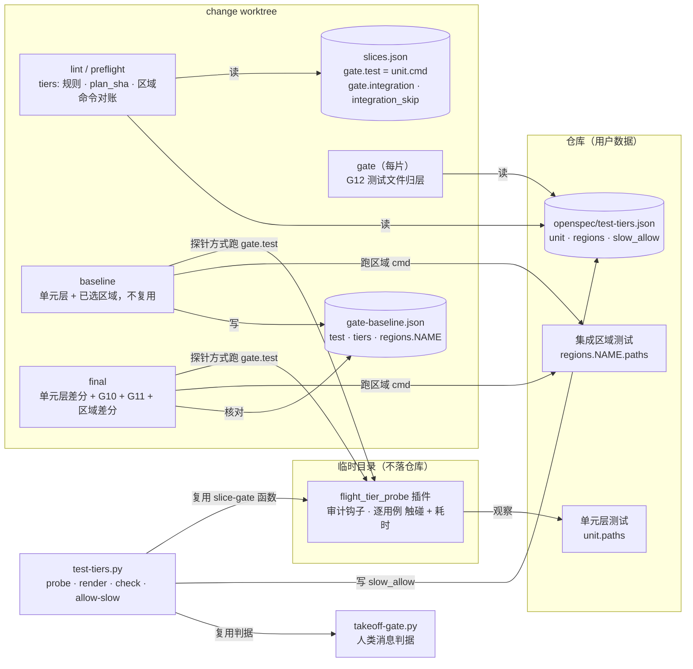

## Context

- **现状**（本仓 main `a20e532`，`template/.claude/hooks/slice-gate.py`）：
  - `lint_plan(data, change_dir=None)`（`:421`）校验切片、`gate.test`、`gate.checks`；按 change 目录上两级找仓库默认检查 `gate-checks.json`（`_repo_default_checks`，`:393`）。调用方 `cmd_lint`（`:986`）与 `cmd_preflight`（`:1625`）。
  - `plan_sha`（`:247`）哈希 `[test, lint, typecheck, [[id, verify]]]`，有 `gate.checks` 时追加 `[name, baseline]`。
  - `run_test_gate(cmd, root)`（`:182`）经 `PYTEST_ADDOPTS` 注入 `--junitxml`，可度量的 exit 1 给出失败用例集；`full_suite_verdict`（`:293`）按基线 `test.failed` 逐条差分。
  - `cmd_gate`（`:1222`）跑 G1–G8，G3 配对与 G4 GWT 用区间内的测试文件列表（`:1258-1260`）。
  - `cmd_baseline`（`:1407`）次序：候选复用（`:1435`）→ 全量（`:1457`）→ lint / typecheck → 每片 verify → `gate.checks`（`:1508`）→ 运行期间改动判定（`:1547`）→ 写回耗时、入池 → 写 `gate-baseline.json`。
  - `cmd_final`（`:1354`）次序：G7 → lint / typecheck → G7 绿才跑全量（`:1382`）→ `gate.checks`（G9，`:1387`）。
  - G7 实跑用临时 pytest 插件（`G7_PLUGIN`，`:85`；`_pytest_outcomes`，`:859`）：插件写进临时目录、目录加进 `PYTHONPATH`、`-p` 加载，不落被测仓库。
  - 失败编号 G0–G9 已用；G10–G12 空闲。
  - 耗时现状：只有 baseline 记全量墙钟（`bl.test.sec` / `full_suite_sec`）；`run_test_gate` 不返回耗时；G7 插件（`G7_PLUGIN`）只记 `[nodeid, 结果]`，`_pytest_outcomes` 返回四元组、按二元组解析每行。
  - timeline 备注（`timeline_record`，`:469`）被 `timeline.py` 解析：gate 行取备注首词为切片号、以 ` ok` 结尾判通过（`timeline.py:80-85`），`red` 结尾计红次数。
- **实测**（2026-10-28，Python 3.9.6 / pytest 8.4.2，一次性探针插件 + `sys.addaudithook`）：
  - 本仓 323 个用例里 312 个碰了文件或子进程，11 个纯函数；全量 84s，开探针 101s；最慢单个用例 2.44s。
  - import 也会触发 `open` 事件（`io.open_code` 读源文件、写字节码缓存时还有 `os.mkdir`），必须按调用栈排除 import 机制。
  - `os.path.exists` / `os.stat` 不触发审计事件。
  - `-p` 指向的插件模块找不到时，pytest 打印 `ImportError: Error importing plugin "<name>"`，**退出码 1**（与「有用例失败」同码）。
  - 审计事件名对照 docs.python.org「Audit events table」核实。
- **调用方**：`/opsx-propose` 第 5 步后台跑 baseline；`/opsx-apply` 起飞前 preflight、每片 gate、收口 final；`/opsx-verify` 可直接跑 final；新命令 `/test-tiers` 调用 `test-tiers.py`。
- **用户决策（2026-10-28，决策页 Q1–Q5 全取推荐）**：见 proposal。
- **约束**：
  - 铁律 3 / 9（判据由脚本取得、零 token）、铁律 5（门禁红不收口）、铁律 7（人类审批由机械证据核验）、铁律 10（未配置时行为不变即回退）；
  - ADR `DRAFT-gate-evidence-not-self-reported`：新门禁先回答「判据从哪来、谁能伪造」（D12）；
  - ADR `DRAFT-test-gate-baseline-diff`：失败用例按基线逐条差分；它否决过「自写插件经 `-p` 加载」做差分（包装脚本会覆写 `PYTHONPATH`）——本 change 的探针不承担差分，并且加载失败有回退（D4、D12）；
  - ADR `DRAFT-baseline-reuse-by-content-fingerprint`：本 change 在配置了分层时不走复用（D7、D12）。

C4 组件视图（轻量，`slice-gate.py` 与新脚本 `test-tiers.py`；格式沿用先例 `slice-gate-paired-checks`，plain Mermaid）：

- **边界**：模板负责「哪层何时跑、纯度与耗时怎么判、区域怎么选」；区域怎么切、每层用什么命令由仓库在分层文件里写。
- **关键关系**：`gate.test` 与 `unit.cmd` 由 lint 绑成同一条命令，单元层因此天然进入 `plan_sha`；区域命令留在分层文件，由 preflight / final 与基线记录对账。
- **假设**：仓库用 pytest 时探针全功能；其他 runner 只得到区域运行与 lint，G10 / G11 降级为警告。
- **开放问题**：未选区域长期不跑的回归风险（见 Open Questions）。

## Goals / Non-Goals

**Goals:**
- 单元层 = 基线：飞行的 baseline / final 只跑单元层与本 change 选中的区域。
- 「纯函数」与「<3 秒」两条单元层定义由脚本逐用例判定，不靠自报。
- 区域发起靠判断，但判断必须显式写进计划、随飞行计划审批；漏表态由 lint 拦下。
- 新用例先定层：scenario 测试的位置由 lint 管，切片里的其他测试文件由 G12 管。
- 慢单测的人工放行有人类原话证据。
- 一条命令完成重划分：实测分类 → 审批页 → 搬家 → 复核。
- 每次门禁（gate / baseline / final）分别报告单元层与集成层耗时，进飞行记录（铁律 8）。
- 未配置分层文件时行为、输出、`plan_sha` 与本 change 之前一致。

**Non-Goals:**
- 不改写测试逻辑（把「经子进程测纯逻辑」的集成测试重写成单元测试）。
- 集成区域不设耗时上限。
- 不支持非 pytest runner 的探针（只降级）。
- 未选区域不兜底全跑。
- 本 change 不重划分本仓自己的测试，本仓不放分层文件（Q4）。

## Decisions

### D1 分层文件：位置、形状、为什么 `unit` 也带 `cmd`
- **位置**：`<change_dir>/../../test-tiers.json`，与 `gate-checks.json` 同一解析；安装后的仓库（`openspec/`）与本仓（`template/openspec/`）两种布局都成立。
- **形状**：`{"unit": {"paths", "cmd"}, "regions": {NAME: {"paths", "covers", "cmd"}}, "slow_allow": {NODEID: {"reason", "approved"}}}`；路径相对 git toplevel，glob 语义与 `owns` 相同（`glob_match`）。
- **不认识的字段报错**：写成 `cover` 这类笔误时区域会静默失去 `covers`，lint 再也逼不出表态。宁可红。
- **区域名 `[a-z0-9-]+`**：它出现在失败编号文本与 `gate-baseline.json` 键里，限制字符集免去转义问题。
- **`unit.cmd` 与 `gate.test` 必须相同**：「基线就是单元层」由 lint 机械保证；`gate.test` 已在 `plan_sha` 里，单元层命令改了基线自然过期。
- **否决**：只在 `slices.json` 写 `gate.test`、分层文件不写单元命令——lint 无从判断 `gate.test` 是否只跑单元层，全量会悄悄继续当基线。
- **否决**：pytest marker 分层（Q1 否决）——只适用 Python，区域要靠多个 marker 组合。

### D2 区域选择：显式写进计划，`covers` 逼出表态
- **形状**：`gate.integration = [NAME, …]`，`gate.integration_skip = {NAME: 理由}`；与 `gate.checks` / `checks_skip` 同一模式。
- **表态规则**：区域 `covers` 与任一切片 `owns` 相交（`globs_intersect`）→ 必须选上或写理由。这是「你或用户判断」的机械化：判断由模型写、人在 spec.html 里批，漏写由 lint 拦。
- **只写区域名，不抄命令**：命令只在分层文件里有一份；`plan_sha` 只追加区域名（D9），命令改动由 preflight / final 与基线记录对账。
- **否决**：按 `covers` 自动选区域——用户要求「判断确实影响到真实文件时」才发起，`covers` 相交只是信号，可能只改了注释。
- **否决**：final 兜底全跑所有区域——违背用户「仅在……时有区域地发起」；漏网风险靠表态规则与审批兜住。

### D3 新用例先定层：lint 管 scenario，G12 管其余
- **lint**：`scenario_tests` 指向的文件必须匹配 `unit.paths` 或已选区域的 `paths`。tasks 阶段写骨架时就得先定层。
- **G12**（`cmd_gate`，接在 G4 之后）：本切片区间改动、仍存在、文件名符合测试文件命名的文件，路径必须落在单元层或已选区域；用测试文件命名（`TEST_FILE_RE`）而不是 `is_test_path`，免得 `conftest.py`、测试数据文件被误判。
- **为什么要 G12**：执行体额外写的测试若落在任何层之外，baseline 与 final 都不会跑它——这是静默失败。
- **否决**：G12 放进 final——执行体在自己的切片里就能挪文件修好，放 final 要多一轮修复。

### D4 探针：注入、事件、排除、合并、回退
- **注入**：`run_test_gate(cmd, root, probe=False)` 新增参数；`probe=True` 时插件源 `TIER_PROBE_PLUGIN` 写进与 junit 相同的临时目录，`PYTHONPATH` 前置该目录，`PYTEST_ADDOPTS` 追加 `-p flight_tier_probe`，`FLIGHT_TIER_OUT` 指向临时 jsonl。与 G7 插件同法。
- **窗口**：用 hookwrapper 包住 `pytest_runtest_setup` / `call` / `teardown`，只在这三段内记录；失败报告生成（读源码拼 traceback）不在窗口内。
- **事件表**：见 spec 第三条 Requirement；按事件名集合先过滤，命中才查调用栈，控制开销。
- **排除**：调用栈上有 `importlib._bootstrap*`、`zipimport` 或 `_pytest.assertion.rewrite` 帧时不计——实测 import 会触发 `open` 与 `os.mkdir`。
- **耗时**：`pytest_runtest_logreport` 的 `report.duration` 三段相加（Q5）。
- **输出**：会话开始写一行开跑记录；每个用例 teardown 后写一行 `{nodeid, sec, hits}`；写之前先关窗口，免得记到插件自己。
- **xdist**：主进程与 worker 都可能写同一 nodeid；读取时按 nodeid 合并，耗时取最大、触碰取并集。追加写、每行一条，不依赖单进程。
- **回退**：输出含 `Error importing plugin "flight_tier_probe"`（实测退出码 1，与用例失败同码）→ 去掉探针重跑一次，`probe=None`、`probe_why` 写明「探针插件加载失败（包装命令覆写了 PYTHONPATH？）」；差分用重跑结果。没有开跑记录 → `probe=None`、「没有探针输出（不是 pytest？）」。
- **返回**：`res["probe"] = {nodeid: {"sec": float, "hits": {"文件"|"子进程"|"网络": 样例}}} | None`，`res["probe_why"]`。
- **否决**：把插件放进 hooks 目录直接加 `PYTHONPATH`——hooks 目录里有 `timeline.py` 等可导入模块，会遮住被测仓库的同名模块。
- **否决**：解析 `--durations` 输出取耗时——拿不到触碰信息，还要第二套解析。

### D5 G10 慢单测
- **阈值**：常量 `UNIT_MAX_SEC = 3.0`，不可配置（用户定的规则，不给环境变量开口，见 D12）。
- **候选与确认**：耗时 ≥ 3.0 为候选；用 G7 同款前缀（`_g7_runner(gate)`）在同一次 pytest 调用里带探针重跑全部候选（`--rootdir` 为 toplevel）；重跑 ≥ 3.0 或重跑没有该 nodeid 的记录（如 `cd` 子目录跑导致 nodeid 不同）→ 确认。fail-closed。
- **纯函数判定**：`tier_verdicts(probe, probe_why, rerun, allow)` → `(failed, warnings)`，不做 I/O；候选列表由 `slow_candidates(probe)` 给出，重跑由调用方做。判定逻辑因此能用纯函数单测覆盖，不必每个场景真睡 3 秒。
- **放行**：nodeid 在 `slow_allow` → 警告，带 `approved`；否则失败。
- **否决**：一次超线即红（Q5 否决）——切片并行时负载抖动会让飞行误停。
- **否决**：每个候选单独起一次 pytest——候选通常很少，同一调用足够，省进程启动。

### D6 G11 单测不纯
- 任何触碰 → 失败，写明类别与第一条样例。
- 不可度量 → 一条警告 `G10/G11 不可度量：<原因>`，不判红（与「非 pytest 按退出码判」同一降级口径）。
- **已知盲区**：`os.stat` 类不触发事件；C 扩展直接做的 I/O 不经审计钩子。写进文档与 ADR。
- **否决**：静态扫描测试源码找 `open` / `subprocess`（Q3 选了门禁强制实测）——间接调用看不见，误报也多。

### D7 baseline 接线
- **先校验后动作**：分层文件或区域选择不合法 → `die`，不写运行标记，与 `gate.checks` 形状校验同位置。
- **不走增量**：配置了分层时 `_baseline_candidates(..., full=True)`。单元层按定义每个用例 <3 秒，复用机器省不了多少；而复用会跳过探针，G10 / G11 无从判。lint / typecheck 的沿用依赖复用命中，随之不沿用。
- **次序**：单元层（原全量位置，带探针，判 G10 / G11，失败进 `reasons`）→ lint / typecheck → 每片 verify → **已选区域** → `gate.checks` → 运行期间改动判定。区域放在 verify 之后，与 checks 同属「更贵、按需」的一段。
- **区域记录**：`regions.NAME = {exit, sec, cmd[, failed]}`；可度量的红记 `failed` 并警告；不可度量的红进 `reasons`。区域每次实跑，不沿用。
- **`tiers` 记录**：`{"measured": true}` 或 `{"measured": false, "why": …}`，供 timeline 与人看。
- **verify 推导**（`_derive_verify`）照旧：单元层是直接 pytest 调用时，落在单元层里的 verify 仍可由它的 junit 推导；区域测试的 verify 照跑。
- **入池不变**：池只按 `cmd_key` 匹配，分层仓库的单元命令与他人不同，不会误用；不改池逻辑。

### D8 final 接线
- **次序**：G7 → lint / typecheck → G7 绿时：单元层（探针 + 差分 + G10 + G11）→ 已选区域逐个差分 → `gate.checks`（G9）。
- **差分复用**：把 `full_suite_verdict` 的差分部分抽成 `_diff_verdict(label, tg, known_failed)`；单元层用 `test` 标签（文本与现状一致），区域用 `region NAME`。
- **区域记录核对**：基线没有 `regions.NAME`，或记录 `cmd` ≠ 分层文件当前 `cmd` → `G2 region NAME：基线缺记录或命令已变，重跑 baseline`，不跑该区域。
- G7 红时沿用现有警告「G2 全量未跑」，单元层与区域都不跑。

### D9 preflight 与 `plan_sha`
- `plan_sha` 在 `gate.integration` 非空时追加 `["integration", 区域名列表]`；其余情况结果不变（兼容旧基线）。
- preflight 紧接 `plan_sha` 校验之后（早于基线 commit 祖先校验与按内容判过期）：分层文件存在且有已选区域时，逐个核对基线 `regions.NAME.cmd` 与分层文件当前命令，缺记录或不符 → 「基线过期：区域 NAME …；重跑 baseline」。放在内容判过期之前，是为了让人看到具体是哪个区域的命令变了，而不只是「test-tiers.json 有改动」。
- 分层文件本身的其他改动（`paths`、`covers`、`slow_allow`）不让基线过期：它们不改变基线跑了什么；首次起飞前的内容差异判定（ADR 复用）仍会把它当代码树改动。

### D10 慢单测放行：`allow-slow`
- **判据**：复用 takeoff-gate 的 `locate_cli` / `human_text` / `parse_ts` / `summarize`（按路径导入，不改 takeoff-gate）；取**时间最新**的一条人类消息，须同时含函数名与放行词。
- **为什么取最新一条**：门禁红后飞行停下，人回复放行，模型随即运行 `allow-slow`；取最新一条避免拿很久以前的一句话当证据。
- **写入**：`approved = "<ISO 时间> · <摘要 ≤40 字>"`；保留分层文件其余键，`ensure_ascii=False`、缩进 2。
- **谁能绕过**：直接编辑 JSON 可以绕过脚本。飞行中执行体改分层文件会被 G6 所有权拦下（文件在 change 目录外，不在任何 `owns` 里时）；飞行外的改动出现在 PR diff 里。与起飞批准的信任模型相同。

### D11 `/test-tiers` 命令与 `test-tiers.py`
- **命令即逻辑**：`template/.claude/commands/test-tiers.md`，无同名 skill（同 `/opsx-mini`、`/pr-ship`）。
- **步骤**：
  1. `/opsx-mini` 留痕（重划分只搬测试、不改被测代码与断言；范围写测试目录与分层文件）；
  2. `probe --json`：实测分类，记下合计数；
  3. 模型按 import 与被测模块起草划分稿 `{tiers, moves}`：区域按模块 / package / library，`covers` 写被测源码 glob；混合文件按 nodeid 拆；
  4. `render` 出审批页，打印绝对路径，停下等人类批准；
  5. 批准后 `git mv` 整文件、手工拆混合文件（保留 GWT 注释）、写分层文件；
  6. 复核：`check` 退出 0；再 `probe`，合计相等、单元层零触碰、无 ≥3 秒单测（有则提速或走放行）；`unit.cmd` 与各区域 `cmd` 各跑一次全绿；
  7. 提示进行中 change 的 `gate.test` 改成 `unit.cmd`（lint 会报），`/opsx-mini --done`；不代 commit。
- **非 pytest 仓库**：跳过 `probe`，模型静态推断并在审批页标「未实测」；门禁侧 G10 / G11 降级。
- **`test-tiers.py` 复用 slice-gate**：按路径导入 slice-gate（`_load_tiers_file`、`tiers_matching`、`run_test_gate`、`TEST_FILE_RE`、`toplevel`），不复制逻辑；slice-gate 不反向依赖它。
- **`check` 的文件来源**：`git ls-files --cached --others --exclude-standard`，取文件名符合测试命名的。
- **`render`**：Python 字符串模板生成单文件 HTML（不依赖外网），导出按钮下载 Markdown（含划分摘要与人类批注框）。模型不逐字写 HTML。

### D12 判据从哪来、谁能伪造；与在役 ADR 的关系
- **判据**：探针记录与重跑耗时由 slice-gate 自己运行取得；插件源在 slice-gate 内、写进临时目录，执行体改不到。
- **阈值不开口**：不设环境变量覆盖 3 秒（不同于 `FLIGHT_G7_TIMEOUT`），免得被门禁的一方在命令前缀里改判据。测试用纯函数判定（D5）解决「不想真睡 3 秒」。
- **被测代码能否骗过探针**：测试可以导入 `flight_tier_probe` 改它的状态，属蓄意作弊，评审可见；审计钩子装上后不能卸载。
- **放行**：D10。
- **判定不出时**：区域记录缺失 → final 红；分层文件读不出 → lint 红、baseline 停下；重跑取不到耗时 → 按超线算。都是 fail-closed。唯一的降级是探针不可度量时 G10 / G11 只给警告，失败用例差分照常（与非 pytest 全量按退出码判同一取舍）。
- **与 `DRAFT-test-gate-baseline-diff`**：差分仍只靠 junit；探针只服务 G10 / G11，加载失败时回退保住差分。不 supersede。
- **与 `DRAFT-baseline-reuse-by-content-fingerprint`**：配置了分层时不复用，是该 ADR 适用范围外的新情形（单元层快、复用会跳过探针）；未配置时复用完全照旧。不 supersede。

### D13 命名
- 分层文件 `test-tiers.json`；计划字段 `gate.integration` / `gate.integration_skip`；lint 前缀 `tiers:`。
- 失败编号：`G10 slow unit test`、`G11 impure unit test`、`G12 tiers`、`G2 region <NAME>`。
- 插件模块 `flight_tier_probe`、环境变量 `FLIGHT_TIER_OUT`；常量 `UNIT_MAX_SEC`、`TIER_PROBE_PLUGIN`、`TIER_FILE`。
- 触碰类别用中文「文件 / 子进程 / 网络」，与门禁其余文本一致。

### D14 分层耗时报告 `tier_sec`
- **来源**（2026-10-28 用户追加：每次跑门禁区分单元层、集成层耗时）：
  - **G7**：`G7_PLUGIN` 在环境变量 `FLIGHT_G7_SEC` 存在时，另把每个用例三个阶段 `report.duration` 之和按 `[nodeid, 秒]` 写进该文件；结果行格式不变。`_pytest_outcomes(..., durations=None)`、`scenario_status(..., durations=None)` 加可选关键字参数，传入 dict 时才设该变量并回填；返回形状不变，既有调用方不受影响。
  - **单元层**：baseline / final 里围住「`run_test_gate(gate.test, probe=True)` + `_unit_tier_verdict`」计墙钟（含探针回退重跑与候选重跑）。
  - **区域**：围住每个区域的 `run_test_gate(rcmd)` 计墙钟；baseline 的 `regions.NAME.sec` 即此值。
- **归层**：纯函数 `tier_seconds(durations, tiers)` 按 nodeid 的文件部分调 `tiers_matching`，取第一个匹配（单元层优先）；都不匹配计入 `unclassified`（lint 与 G12 正常时不会出现，出现即说明有漏网文件，照实报出）。
- **为什么 G7 用用例耗时、层运行用墙钟**：G7 一次 pytest 调用混跑两层，墙钟无法拆分；层运行各自独立，墙钟才是真实成本（含收集与启动）。两者相加即「本次门禁花在该层上的秒数」，口径写进 spec。
- **为什么不计 verify / lint / checks**：verify 是混层的切片命令，拆分需要再注入耗时插件，收益低；lint / checks 不属于任何测试层。
- **输出位置**：结果 JSON 的 `tier_sec`（baseline 同时写进 `gate-baseline.json`）；`summary` 末尾追加；timeline 备注把「单元 X.Xs · 集成 Y.Ys」插在结论词之前——`timeline.py` 的切片号与 ` ok` / `red` 解析不受影响，飞行记录逐行打印即可见，`timeline.py` 不改。
- **未配置分层时**：不设 `FLIGHT_G7_SEC`、不计时、不加键，输出逐字不变（铁律 10）。
- **切片**：放在 S5（依赖 S2），因为 baseline / final 的单元层与区域运行由 S2 接入；S2 不感知耗时报告。

## Risks / Trade-offs

- [未选区域里的回归不会被本 change 跑到] → 表态规则 + 计划审批；`/test-tiers check` 可放进 CI 定期全跑（不在本 change）。
- [探针开销拉高耗时，接近 3 秒的用例被误判] → 只对候选重跑确认；实测全量开销约 20%，单元层用例本身应远低于 3 秒。
- [包装命令覆写 `PYTHONPATH`，探针失效] → 回退重跑并降级为警告，差分不受影响；文档提示可在 `gate.test` 里直接调用 pytest。
- [探针盲区：`os.stat`、C 扩展 I/O] → 文档与 ADR 写明；`/test-tiers` 的人工审批页是第二道。
- [配置分层后 baseline 不复用] → 单元层快；区域每次实跑，成本与今天全量同量级或更低。
- [`slow_allow` 被直接编辑绕过脚本] → G6 所有权 + PR diff，与起飞批准同一信任模型。
- [`test-tiers.py` 按路径导入 slice-gate / takeoff-gate，私有函数改名会让它坏] → `tests/test_tiers_cli.py` 覆盖，改名时测试先红。

## Migration Plan

- 纯增量：没有分层文件的仓库不受影响；现有 `gate-baseline.json` 照常可读，`plan_sha` 不变。
- 启用：在目标仓库跑 `/test-tiers` 生成分层文件，再把进行中 change 的 `gate.test` 改成 `unit.cmd` 并重跑 baseline。
- 本仓：本 change 合入后另立 change，用 `/test-tiers` 重划分 `tests/`（Q4）。
- 回退：删掉分层文件与计划里的 `gate.integration` / `gate.integration_skip`，行为即回到本 change 之前（铁律 10）。

## Open Questions

- 未选区域的定期全跑由谁负责（CI、`/opsx-archive` 前、还是人工）？本 change 不做。
- 非 pytest runner（jest / go test / cargo test）的耗时与纯度度量是否值得做？本 change 只降级。
- 没有在役 ADR 需要 supersede。
