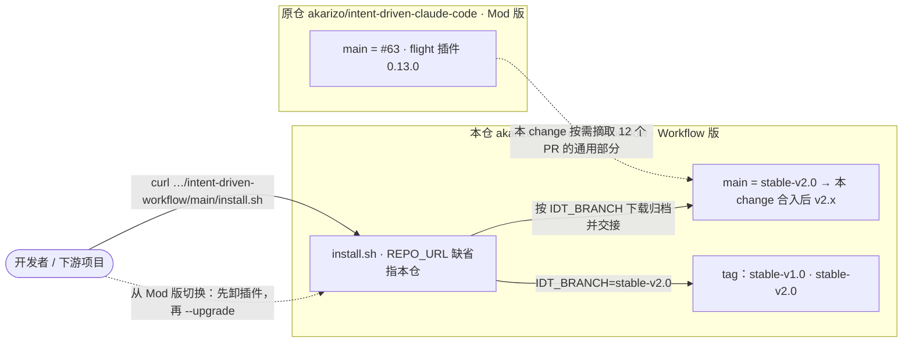
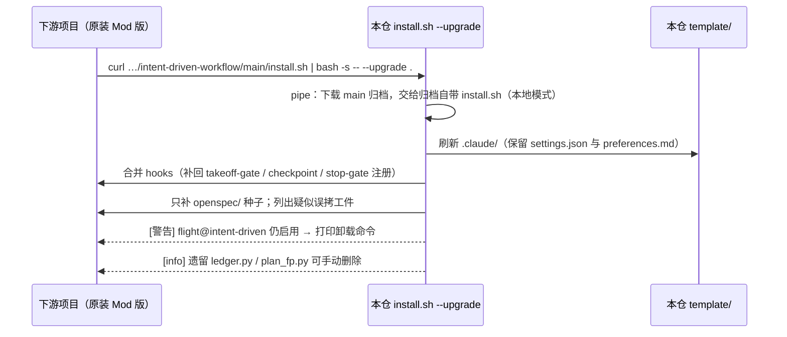

# 设计 · Workflow 版独立成仓，摘入原仓 v2.0 之后的通用改进

**触发器命中**：跨模块（工作流脚本 / agent / 判定器 / 命令与 skill / schema / 安装器 / README）+ 分发方式变更（新仓库、安装器缺省地址）→ 写实质设计。图示约定沿用本仓既有 design：plain Mermaid、轻量 C4（容器图 + 动态图），未单独向用户确认格式。ADR 按 schema 的 MADR-short 模板写，与本仓既有 ADR 一致。

## Context

**三个时点**（原仓 `akarizo/intent-driven-claude-code`，均已核实）：

- **`stable-v2.0` = PR #34 · `49533dd`**：本仓 main 的起点（已推送）。
- **#48 · `36d91c3`**：Workflow 引擎删除前的最后一版。`opsx-apply.js` 与 #37 `85d56b0` 逐字相同（241 行，v2.0 为 210 行），已含 #36 / #37 对引擎的全部修复；同时已混入 flight 插件的账本 / 测量逻辑。
- **原仓 main = #63 · `f7df55f`**：Mod 版现状（插件 0.13.0）；#49 起删掉了 Workflow 引擎。

**摘取范围的核实方法**：逐 PR 看插件与 change 工件之外的 diff；`slice-gate.py` 在 v2.0 / #48 / main 三个时点按函数逐个比对；测试按用例名在三个时点比对。结论：
- 12 个 PR 有通用改进（#35 #36 #37 #38 #40 #41 #45 #46 #47 #51 #55 #60），其余 16 个 PR 是 Mod 专属，#49 是删除引擎；
- #49 之后，判定器共用函数里的通用改动只有 #60 的覆盖率判红一处；
- #48 版测试相对 v2.0 只改了 3 个已有用例（合回派发、propose 基线段落、安装器 `run_install` 辅助函数），没有删除 v2.0 的用例。

**在役 ADR**（本仓 `openspec/adr/`，无 supersede 链断裂）：`DRAFT-apply-as-flight`（调度用确定性脚本、门禁 JSON 决定重试一次或 blocked、评判用机械门禁、测试运行由 hook 留痕）与 `DRAFT-gate-evidence-not-self-reported`（真值源只认转录 / 文件系统 / git / hook；人类批准证据 = 转录里的人类消息）。本设计的每一项都在这两份的框架内：P1 收紧「重试一次或 blocked」的执行，P3 / P5 加强机械门禁，起飞批准不动。

## Goals / Non-Goals

**Goals**
- 本仓 main 成为「v2.0 + 原仓通用改进」的 Workflow 版，每一项改进都能对回原仓的 PR 与 commit。
- 修掉 v2.0 上已知会让飞行静默失真或白跑的缺陷（proposal 的问题表）。
- 下游能用本仓的 `install.sh` 一行安装或升级；从 Mod 版切换过来时有明确提示。

**Non-Goals**
- 不改原仓（含 README）；不在本仓引入 flight 插件、批准带、账本、计划指纹、测量协议、护栏、能力包络、无人值守。
- 不改起飞批准机制与铁律原文；G5 仍读 `evidence.log`、「未见先红」仍只警告。
- 不在本 change 重做 Mod 时期的优化（决策页 R1–R6：final 复用修复门禁、blocked 跳过 fix、批准绑定指纹、意图门禁收窄、落地前预合并、preflight 查 GWT）。

## Decisions

### D1 本仓独立成仓，起点 stable-v2.0，不做 GitHub fork

- **原仓 main 上回滚**：用户否决（不想太激进）。
- **原仓里另起长期分支 `workflow`**：用户否决（不玩分支）。
- **在 `akarizo` 名下再 fork 一份**：原仓本身是 `intent-driven-dev/intent-driven-template` 的 fork；官方文档没写明同账号能否再 fork 同一上游，社区反馈多为落回已有 fork；且 fork 里 `gh pr create` 默认投到上游。
- **选定：`gh repo create` 新建 public 仓库，推 `49533dd` 为 main 并推两个 tag**：历史完整、PR 只会投到自己、main 就是 Workflow 版（已执行）。

### D2 以 #48 时点为摘取基底，删掉其中依赖账本的部分

#48 已含 #36 / #37 对引擎、agent、判定器的修复，也已混入插件的账本 / 测量逻辑。按文件取舍：

- **`workflows/opsx-apply.js`、`agents/integrator.md`、`agents/slice-executor.md`、`skills/openspec-git-discipline/SKILL.md`**：整份取 #48（其中没有插件依赖）。
- **`hooks/slice-gate.py`**：取 #48，删除 `MEASURE_RED`、`g5_ledger_verdict`、`MEASURE_RANK`、`cmd_measure` 与 `measure` 子命令、`gate --evidence/--measure-base` 与 `cmd_gate` 的账本分支、`start --evidence` 与标记的 `evidence=ledger`、护栏（`guard_marker_errors` 与 lint 的 guards 校验）、`_reusable_fix_gate` 与 `final --reuse-fix`；再加 #60 的 `COVERAGE_FAIL_MARKS` 与 `run_test_gate` 里的判定。
- **命令与 skill（`opsx-apply`、`opsx-propose`、`pr-ship`、legacy skill）**：取 v2.0，只补入指名的段落：#48 的 Agent 回退段、#45 的 propose 步骤 4–6（去掉批准带、「授权提交」、护栏措辞）、#47 的 merge-tree 段、#51 的三处 `model: "<main>"`（agent 名用 `code-reviewer`，删去「插件守卫」一句）。
- **`schema.yaml`**：取 v2.0，补 `gate.pytest`、`gate.test` 必填与基线差分说明，不含 `guards`。
- **测试**：取 #48 版测试文件，删 Mod 用例与只为它们服务的辅助函数（`_g5*`、`_ledger_gate`、`_measure_ev`、`_set_guards`、`ledger_append` 等）；`test_slice_gate_reuse_preflight.py` 去掉 4 条 reuse 用例后改名 `test_slice_gate_baseline_preflight.py`；覆盖率与种子用例取原仓 main。

替代方案「从 v2.0 逐个 hunk 手补」被否：#36–#48 之间同一函数被改多次（如 `cmd_final` 先后经 #36 / #45 / #46），逐 hunk 重放容易漏改或错序；以 #48 为底、做减法，删除清单可以逐项核对。

### D3 起飞批准不动

保持 v2.0：`takeoff-gate.py` 认会话转录里人发的 `/opsx-apply`（或 ≤40 字批准词）且晚于计划工件 mtime。原仓 #35 的「按钮按压 + 计划指纹入账本」依赖插件 UI，不可移植；无插件的指纹方案（UserPromptSubmit hook 记指纹）是新设计，属决策页 R3，另立 change。

### D4 安装器：缺省地址改本仓，其余按原仓终版

- `REPO_URL` 缺省 `https://github.com/akarizo/intent-driven-workflow`；`IDT_BRANCH` 缺省 `main`；
- pipe 模式按原仓 #38 的终版（引导 + 交接，契约见带入的 `DRAFT-installer-versioned-with-template`），不含原仓 #49 的「退役 hook 注册移除」与 #51 的「已迁入插件」清单（这些文件在本仓仍在用）；
- 升级保留 `settings.json` 与补缺键（#35 #36）、种子清单与误拷清单（#55）；
- **Mod 版退场**（本仓新增）：读目标 `settings.json`，`enabledPlugins["flight@intent-driven"] is true` 时打印警告与两条卸载命令（命令已在 Claude Code 2.1.300 用 `--help` 核过）；列出存在的 `.claude/hooks/ledger.py`、`plan_fp.py`。只提示不执行：`settings.json` 是用户数据，安装器的一贯做法是不替用户删。Mod 版安装器移除过的三条 hook 注册，由现有的按命令串合并自然补回，用测试钉住。

### D5 scenario 映射与骨架：先在 v2.0 基底上实跑

搬来的用例原本就是对应改进的验收测试。做骨架时先在 v2.0 基底上跑一遍：失败的加 `xfail(strict=True)`（实现后去掉）；已经通过的不加标记，作为基底已成立的行为照常计入 scenario（例如「升级补回 v2 hook 注册」在 v2.0 的合并逻辑下本就成立）。哪些用例在基底上已通过，以实跑结果为准，写进切片包。

### D6 执行方式：飞行外、主会话直做

本 change 大半是「从历史版本取文件 + 指名的几处补丁」，切成并行执行体收益小，取舍上下文全在主会话手里。按切片顺序逐片实现，每片：去掉本片骨架的 xfail → 实现 → 本片 verify 绿 → `slice-gate.py gate`（恢复后的判定器）。收口跑 `slice-gate.py final`、全量 pytest、`openspec schema validate intent-driven`、hooks compileall，再派一个不带主会话上下文的 code-reviewer（显式 `model`）审整条分支。
已知局限：本仓 openspec 嵌在 `template/` 下，飞行外跑测试时 `test-evidence.py` 找不到 change 目录、不写 `evidence.log`（飞行中靠切片标记的绝对路径才能记）。先红后绿的证据留在会话转录里；G5 在本 change 的切片门禁上会给出「无 evidence.log」警告（v2.0 判法，不判红），如实记入 PR。

### D7 PR 投到本仓 main

功能分支 `worktree-workflow-edition`（从 `49533dd` 起）推到本仓，`gh pr create --repo akarizo/intent-driven-workflow --base main`；预合并目标是本仓 main（当前即 `49533dd`，不会有冲突）。合入后由用户决定是否打 `stable-v2.1`。

## Risks / Trade-offs

- [#48 版 `slice-gate.py` 做减法时误删共用逻辑] → 删除清单按函数列在 D2；保留的 65 条既有与摘取用例全绿；独立评审逐项核对删除清单。
- [两个版本长期分叉，通用修复要双向搬] → `DRAFT-workflow-edition-repo` 写明「按需摘取、proposal 写明来源 PR / commit」；本 change 的 proposal 即为样例。
- [下游从 Mod 版切换后插件仍启用，继续拦截 `/opsx-apply`] → 安装器醒目提示 + README 切换步骤；不自动卸载（D4）。
- [原仓 README 不提本仓，用户找不到 Workflow 版] → 原仓不动是用户的约束；本仓 README 写明关系。是否在原仓加一行指引留作 Open Question。
- [git < 2.38 时 `/pr-ship` 的 `merge-tree --write-tree` 不可用] → 命令文档写明版本要求；退出码非 0 / 1 时报告错误并停下，不会误判为无冲突。
- [G7 实跑让门禁变严：别名 xfail、测试体内 skip 现在判红] → 这是修复假绿；README 与 CHANGELOG 级说明放进 PR 正文。
- [`gate.test` 必填对 v2.0 用户是 BREAKING] → lint 报错信息点名 `gate.test`；README 的升级说明提一句。

## Migration Plan

1. 新用户：`curl -fsSL https://raw.githubusercontent.com/akarizo/intent-driven-workflow/main/install.sh | bash -s -- <项目>`。
2. 已装 v2.0（原仓 `stable-v2.0`）的项目：同一条命令加 `--upgrade`；进行中的 change 若 `slices.json` 没写 `gate.test`，补上再起飞。
3. 已装 Mod 版的项目（如 afa）：先 `claude plugin uninstall flight@intent-driven -s project` 与 `claude plugin marketplace remove intent-driven --scope project`，再 `--upgrade`，按安装器提示手动删遗留文件，重开会话。
4. 回到 Mod 版：用原仓的 `install.sh --upgrade` 与它的插件安装步骤（原仓文档）。
5. 回滚本 change：本仓 main revert 合入提交即可；不涉及数据迁移。

## Open Questions

- 是否在原仓 README 加一行指向本仓（需原仓单独 PR；当前约束是原仓不动）。
- 决策页 R1–R6 的跟进顺序（建议 R4 意图门禁收窄 → R1 final 复用修复门禁 → 原仓 `baseline-incremental-reuse` 的移植 → R3 批准绑定指纹）。
- 合入后是否打 `stable-v2.1`。
- 无需 supersede 任何在役 ADR。
